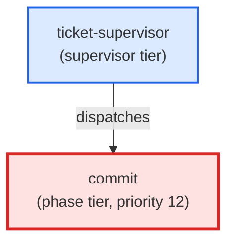

# commit

**Commit agent that runs the shared commit step. Takes an explicit file list and an optional caller-written message file (writes one following the project's commit-message rules when none is given), shows the message and file list to a person for confirmation on the interactive path, then runs commit_changes.py once with that exact list and file and relays the step's answer unchanged in a {status, commit_answer, earlier_answers} envelope. On a hook_failed answer it follows the answer's remedy disposition: engage-specialist returns the handoff, mechanical-autofix is fixed in its own context and re-run with a fresh call of the step up to the configured retry limit, author-clears returns a blocker. Never stages, records or kills by hand, never bypasses checks, and refuses --no-verify and force-push absent explicit user authorisation per the Git Safety Protocol. Use when: user types /commit; asks to commit named files; asks to commit with a specific message; a build route dispatches the commit phase.**

| Field | Value |
|-------|-------|
| Model | sonnet |
| Tier | phase |
| Priority | 12 |
| Portable | Yes |
| Sign-off capable | Yes |

---

## When to Use

### Spawned By

- `ticket-supervisor`
---

## Knowledge Flow

| Channel | Source | Injection Mode | Description |
|---------|--------|----------------|-------------|
| 1 | template description field | — | — |
| 3 | ticket_path from ticket-supervisor | — | — |
| 6 | project files read during execution | — | — |
| 7 | bash command output (git, build, tests) | — | — |
| 9 | agent memory store | — | — |
---

## Spawn and Dependency

---

## Input / Output Contract

### Inputs

| Name | Type | Description |
|------|------|-------------|
| `paths` | file_list | Explicit list of repo files to commit (never a directory, glob or "all") |
| `message_file` | file_path | Path of a caller-written commit message file; when absent this agent writes one |
| `ticket_path` | file_path | Absolute path to the ticket markdown file (supervised path) |
| `run_or_ac_id` | string | The run id or acceptance criterion id a supervised call commits for |

### Outputs

| Name | Type | Description |
|------|------|-------------|
| `sign_off_comment` | sign_off_comment | Reply envelope {status: ok | handoff | blocker, commit_answer, earlier_answers} and, with a ticket_path, a sign-off comment with the same status |

### Mutates (Side Effects)

| Name | Type | Description |
|------|------|-------------|
| `ticket_frontmatter_agents_status` | — | Sets agents.commit to signed_off or failed |
| `sign_offs_checklist` | — | Checks the commit checkbox with timestamp |
| `implementation_artifacts` | — | Files created or modified during phase execution |
---

## Tools Available

| Tool |
|------|
| `Bash` |
| `Read` |
| `Edit` |
| `Write` |
| `Skill` |
---

## Skills Used

| Skill | Mode | Condition |
|-------|------|-----------|
| `signoff` | conditional | When invoked with a ticket_path, load signoff to record your phase sign-off on the ticket. |
| `precommit-autofix` | always | — |
---

## Configuration

*No configuration keys declared.*
---

## Contributor Notes

### Key Behavioral Patterns

| Pattern | Trigger | Behavior | Related Agent |
|---------|---------|----------|---------------|
| Conditional Behavior | no explicit file list was given | ask the user which files to commit | `None` |
| Conditional Behavior | you write a message for Python | SQL, or YAML files that contain a `DECISION HISTORY` | `None` |
