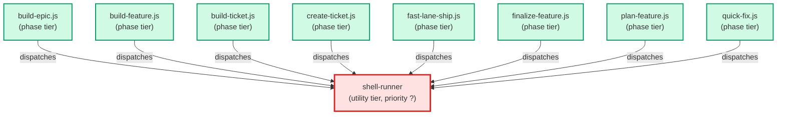

# shell-runner

**Runs exactly one given command line, once, unchanged, and relays its exit
status, stdout and stderr verbatim. The one narrow shell executor every
workflow shell step is dispatched to (ADR-070): it holds no allow-list of
commands, makes no decision, runs no compound or substituted command, and
declines anything that is not "run this one command".
Use when: a workflow step names one exact command line (absolute paths) and
asks for it to be run and its output relayed word for word.
(internal — dispatched by the workflow scripts, not user-facing; never a
ticket phase)**

| Field | Value |
|-------|-------|
| Model | haiku |
| Tier | utility |
| Priority | — |
| Portable | Yes |
| Sign-off capable | No |

---

## When to Use

### Spawned By

- `build-epic.js`
- `build-feature.js`
- `build-ticket.js`
- `create-ticket.js`
- `fast-lane-ship.js`
- `finalize-feature.js`
- `plan-feature.js`
- `quick-fix.js`
---

## Knowledge Flow

| Channel | Source | Injection Mode | Description |
|---------|--------|----------------|-------------|
| 1 | template description field | — | — |
| 7 | bash command output (the one dispatched command, verbatim) | — | — |
---

## Spawn and Dependency

---

## Input / Output Contract

### Inputs

| Name | Type | Description |
|------|------|-------------|
| `command` | string | The one command line to run, exactly as given |

### Outputs

| Name | Type | Description |
|------|------|-------------|
| `reply` | json | Either a result {command, exit_status, stdout, stderr} or a decline {declined, agent, reason} with no exit_status key |

### Mutates (Side Effects)

| Name | Type | Description |
|------|------|-------------|
| `command_effects` | — | Whatever effects the dispatched command itself has -- this agent adds no mutation of its own beyond running it |
---

## Tools Available

| Tool |
|------|
| `Bash` |
---

## Skills Used

*No skills declared.*
---

## Configuration

*No configuration keys declared.*
---

## Contributor Notes

### Key Behavioral Patterns

| Pattern | Trigger | Behavior | Related Agent |
|---------|---------|----------|---------------|
| Non-Zero Exit Is Still A Result | the command runs and exits non-zero | report the command's real exit status, stdout and stderr as a result, never as a decline | `None` |
| Decline Anything Else | the request is not exactly one command line to run (a compound line, a request to choose, fix, retry or substitute a command, edit files, write code, or act as another agent) | run nothing and reply with a decline naming yourself and the reason, with no exit_status key | `None` |
