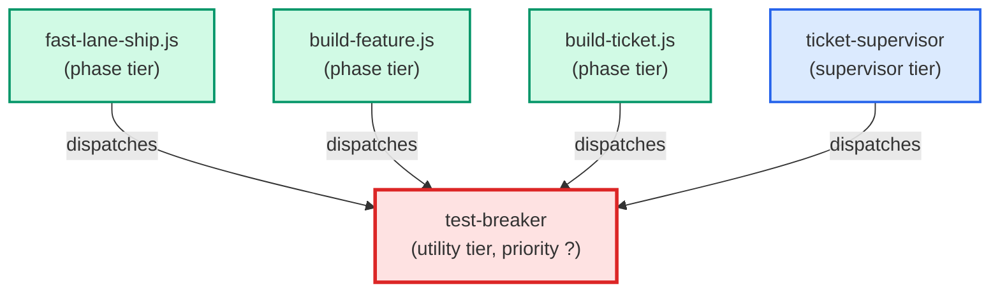

# test-breaker

**Wrong-version preparer (TQ-500g-1-iv). Reads the finished code and, for each
named wrong version a guarding test must catch (its must_catch string), replies
with the minimal replacement (exact old snippet, new text) that does what the
name says and nothing else. A name that describes behaviour the code does not
have, or is too vague to act on, is reported as could_not_prepare with a
one-line reason; it is never dropped. Read-only: it writes no file. A
deterministic writer step validates the reply, applies the replacements to
copies outside the working tree, computes the diff and writes the alterations
manifest. It never runs tests and never says whether a test would catch
anything: the shared wrong-version runner applies each alteration and decides.

Use when: a build route has finished the code and the tests and must prepare
the named wrong versions before the wrong-version runs. It wrote neither the
code nor the tests of the work, which is why it is not the coder or the test
writer.
(internal — invoked by build routes only)**

| Field | Value |
|-------|-------|
| Model | sonnet |
| Tier | utility |
| Priority | — |
| Portable | Yes |
| Sign-off capable | No |

---

## When to Use

### Spawned By

- `fast-lane-ship.js`
- `build-feature.js`
- `build-ticket.js`
- `ticket-supervisor`
---

## Knowledge Flow

| Channel | Source | Injection Mode | Description |
|---------|--------|----------------|-------------|
| 1 | template description field | — | — |
| 3 | dispatch inputs from the build route (work_key, repo_root, requirement_ids, wrong_versions) | — | — |
| 6 | source files read during execution | — | — |
---

## Spawn and Dependency

---

## Input / Output Contract

### Inputs

| Name | Type | Description |
|------|------|-------------|
| `work_key` | string | The work key, copied into the reply as given |
| `repo_root` | directory_path | Absolute repository root (the working tree) |
| `requirement_ids` | list | The requirement ids the wrong versions belong to |
| `wrong_versions` | list | The named wrong versions, each with the in-scope source files (repo-relative POSIX paths) |

### Outputs

| Name | Type | Description |
|------|------|-------------|
| `alterations_reply` | structured_response | One JSON object with one entry per named wrong version, each carrying its replacements |

### Mutates (Side Effects)

| Name | Type | Description |
|------|------|-------------|
| `none` | — | Read-only agent — no filesystem mutations |
---

## Tools Available

| Tool |
|------|
| `Read` |
---

## Skills Used

*No skills declared.*
---

## Configuration

*No configuration keys declared.*
---

## Contributor Notes

### Key Behavioral Patterns

| Pattern | Trigger | Behavior | Related Agent |
|---------|---------|----------|---------------|
| Could-Not-Prepare | A named wrong version describes behaviour the code does not have, or is too vague to act on | Answers that exact name with status could_not_prepare and a one-line reason; never drops the name | `None` |
| Fix-Undone Alias Skip | A dispatched name is 'revert the fix' or 'the fix undone' | Gives the name no entry and notes 'alias skipped: <name>' in anomalies | `None` |
