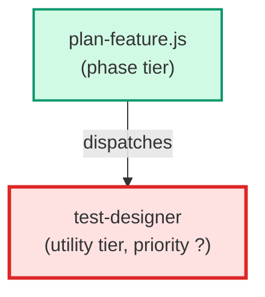

# test-designer

**Code-aware planning agent that runs after the technical planner and before the
build. It reads the pre-pass report, then opens the real code files and the
existing tests the requirement touches, and writes two outputs onto the
requirement record in separate fields: the test design (per needs_test clause,
grounded in files it opened; ACD-2500c) and the file findings (what each
declared file's change must respect; ACD-2500d).

Use when: plan-feature.js has a requirement whose test_intent is written but
whose test design is pending, or whose file findings are missing, and the work
needs an agent that is allowed to read source code and existing tests (ADR-072).**

| Field | Value |
|-------|-------|
| Model | sonnet |
| Tier | utility |
| Priority | — |
| Portable | Yes |
| Sign-off capable | No |

---

## When to Use

### Spawned By

- `plan-feature.js`
---

## Knowledge Flow

| Channel | Source | Injection Mode | Description |
|---------|--------|----------------|-------------|
| 1 | template description field | — | — |
| 6 | project files read during execution | — | — |
| 7 | bash command output (date, git) | — | — |
---

## Spawn and Dependency

---

## Input / Output Contract

### Inputs

| Name | Type | Description |
|------|------|-------------|
| `pre_pass_report` | structured_input | The pre-pass report embedded in the prompt, plus the requirement record ids to work on |

### Outputs

| Name | Type | Description |
|------|------|-------------|
| `test_design` | record_fields | test_spec, test_design_authorship and test_design_opened_files on the requirement record (ACD-2500c) |
| `file_findings` | record_fields | file_findings, file_findings_opened_files and reference_file_path on the requirement record (ACD-2500d) |

### Mutates (Side Effects)

| Name | Type | Description |
|------|------|-------------|
| `requirement_records` | — | Edits the two output groups of a requirement record, field by field; no other field |
---

## Tools Available

| Tool |
|------|
| `Bash` |
| `Read` |
| `Write` |
| `Edit` |
---

## Skills Used

*No skills declared.*
---

## Configuration

*No configuration keys declared.*
---

## Contributor Notes

### Key Behavioral Patterns

| Pattern | Trigger | Behavior | Related Agent |
|---------|---------|----------|---------------|
| Conditional Behavior | every clause of the record's test_intent says needs_test false | report test_design pending with a reason and leave the record's test_required alone | `None` |
