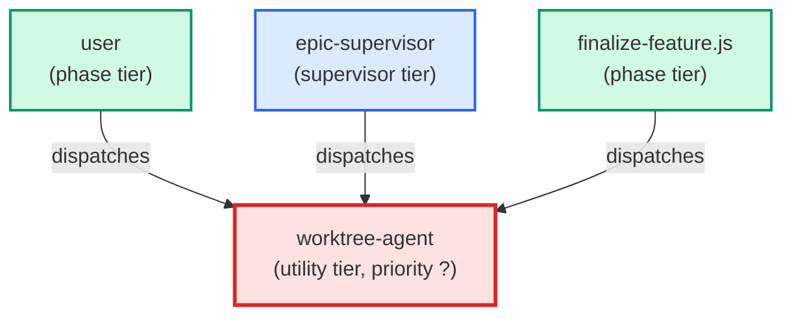

# worktree-agent

**Workspace lifecycle agent. Asks the workspace maker (scripts/worktree.py, see docs/how-to/get-a-workspace.md) for the workspace of a feature branch or ticket, and asks the maker to clear a workspace after a branch merges. Getting a workspace is non-destructive (no confirmation required). Clearing one is destructive and requires an explicit "yes" after the safety-check report. Use when: user types /worktree; asks for a workspace for a branch or ticket; asks to clear or close a workspace after a PR merges.**

| Field | Value |
|-------|-------|
| Model | haiku |
| Tier | utility |
| Priority | — |
| Portable | Yes |
| Sign-off capable | No |

---

## When to Use

### Spawned By

- `user`
- `epic-supervisor`
- `finalize-feature.js`
---

## Knowledge Flow

| Channel | Source | Injection Mode | Description |
|---------|--------|----------------|-------------|
| 1 | template description field | — | — |
| 3 | ticket_path from ticket-supervisor | — | — |
| 6 | project files read during execution | — | — |
| 7 | bash command output (git, build, tests) | — | — |
| 9 | agent memory store | — | — |
---

## Spawn and Dependency

---

## Input / Output Contract

### Inputs

| Name | Type | Description |
|------|------|-------------|
| `action` | string | The action to perform — "create <branch-or-ticket-path>" or "remove <branch-or-workspace-path>" |
| `ticket_path` | file_path | Optional absolute path to the ticket markdown file, used only to derive the kind and slug for the workspace maker. Never written to. |

### Outputs

| Name | Type | Description |
|------|------|-------------|
| `worktree_result` | json | JSON object with worktree_path, branch, status/created/removed and an anomalies array, per the Machine-Parsed Dispatch Output Contract |

### Mutates (Side Effects)

| Name | Type | Description |
|------|------|-------------|
| `workspace_via_maker` | — | Asks the workspace maker to make or clear a workspace (the maker owns the folder, its install and its branch) |
---

## Tools Available

| Tool |
|------|
| `Bash` |
| `Read` |
| `Skill` |
---

## Skills Used

| Skill | Mode | Condition |
|-------|------|-----------|
| `feature` | conditional | When a create request names an epic ticket path (an EPIC-*/ path segment), load feature and run its Epic Workflow with the ticket path as $ARGUMENTS. |
---

## Configuration

*No configuration keys declared.*
---

## Contributor Notes

### Key Behavioral Patterns

| Pattern | Trigger | Behavior | Related Agent |
|---------|---------|----------|---------------|
| Stop-and-Ask | condition requiring user decision or out-of-scope action | Do not proceed to Phase 4. | `None` |
| Conditional Behavior | the maker's answer is not "status":"ok", or it exits non-zero | surface the maker's code and message verbatim and abort | `None` |
| Conditional Behavior | the maker's answer says the workspace was re-readied, not created | report that the maker returned the ready workspace for the same work | `None` |
| Maker Answer Verification | the maker returns an answer | Do not claim the workspace is ready or that hooks are active unless the maker's ok answer says so. Never work around a refusal by hand.
 | `None` |
