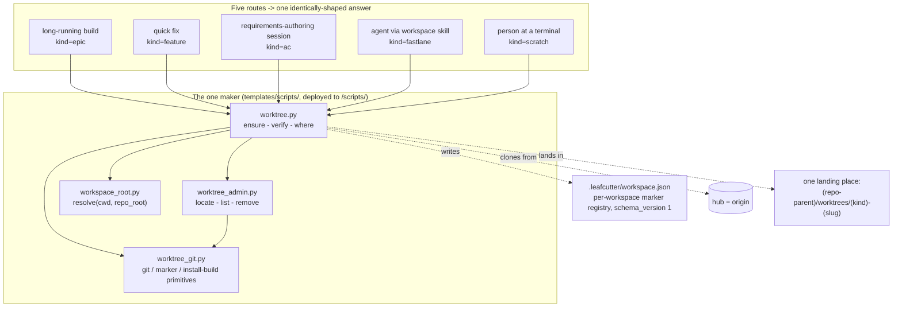

# Delivered — the one workspace maker (2026-09-28): how-to, diagram and CLI reference

Part of [the worktree-consolidation analysis](2026-09-25-worktree-creation-consolidation.md). The decisions taken on 2026-09-25
(per-feature clones, real install files, `origin/main` everywhere, one script run from a skill)
are in section 8 of that page and in [the decision memo](2026-09-25-worktree-isolation-decision-memo.md);
where they change what is written here, they win.

> **Superseded for the answer contract (2026-10-13).** The as-built answer table below is
> replaced by [the answer reference](../reference/workspace-maker-answer.md); the procedures are in
> [get a workspace](../how-to/get-a-workspace.md) and [clear a workspace](../how-to/clear-a-workspace.md).

## 9. Delivered — the one maker (2026-09-28)

`BO-4300a-1` (epic `EPIC-EveryPieceOfSeparateWorkGetsItsWorkspace`) built the standalone
script decision 7 above asked for. It is
[`templates/scripts/worktree.py`](../../../templates/scripts/worktree.py), deployed to
`<install-root>/scripts/worktree.py`, plus a separate uncached project-root resolver
([`workspace_root.py`](../../../templates/scripts/workspace_root.py)) and two helper
modules it imports (`worktree_git.py`, `worktree_admin.py`) — all stdlib-only, all under
the package's file-size ratchet, tracked only under `templates/scripts/` with named
deploy-manifest entries (closing the exact drift this page opened with: `scripts/setup_ticket_worktree.py`
and `templates/scripts/setup_ticket_worktree.py` tracked and diverging). Full decision
record: [ADR-018 Amendment
1](../architecture/adrs/ADR-018-agent-isolation-topology.md#amendment-1--2026-09-27--one-workspace-maker-hardlinked-clones-real-install-files).
Component doc: [Worktree Manager](../architecture/components/worktree-manager.md).

This closes the case study in §1 and the seven-recipe inventory in §2 for the five routes
this AC's own test_spec checks (long-running build, quick fix, requirements-authoring
session, an agent via the workspace skill, and a person at a terminal) — each now gets its
workspace from the one maker, not from whichever of the seven recipes its caller happened
to invoke. It answers open questions 1, 2, 3 and 7 as decided in §8, and leaves 4 (naming —
now one table inside the maker, `BO-4300a-2`), 5 (where adopter workspaces land), 6
(whether `leafcutter-ai/.leafcutter/` should exist) and 8 (a `remove` confirmation token —
delivered here as the `--force` flag; a caller-supplied authorisation token beyond that
remains open) to their own tickets in the epic.

### 9.1 How-to — get a workspace from any of the five routes

Every route runs the same command and reads the same answer shape. There is no separate
recipe per route; only `--kind` and `--slug` change.

1. **Find the maker.** From any directory: `python <install-root>/scripts/worktree.py where`
   prints `{"status": "ok", "path": "<absolute path to worktree.py>"}`. Agents and skills
   should resolve the path this way rather than hard-coding it.
2. **Ask for a workspace.** Run:

   ```
   python <path from step 1> ensure --kind <kind> --slug <your-work-identity> [--repo-root <main checkout>] [--ticket <ticket path>]
   ```

   | Route (this AC's test_spec) | `--kind` |
   |---|---|
   | A long-running build (an epic drive) | `epic` |
   | A quick fix | `feature` |
   | A requirements-authoring session | `ac` |
   | An agent following the workspace skill | `fastlane` |
   | A person at a terminal | `scratch` |
   | A single ticket drive (`--ticket <path>` accepted) | `ticket` |

3. **Halt on anything other than `"status": "ok"`.** Never fall back to the current
   checkout, an agent-claimed path, or a null workspace — see §9.3 for the full error-code
   list.
4. **Take the location from the JSON, never from prose.** Use `workspace_path` (equivalently
   `worktree_path`, kept as an alias) from the `ok` answer. If you passed `--ticket`, use
   `ticket_path_in_worktree` (not the ticket path you passed in) as the ticket's working
   location from then on — the caller never recomputes this mapping itself.
5. **Re-running `ensure` with the same `--kind`/`--slug` is safe.** A `ready` workspace is
   returned as-is (idempotent); a half-made one is repaired.
6. **When you're done:** `python <path> remove --path <workspace_path>` refuses a dirty or
   unpushed workspace unless `--force` is passed, so accidental data loss needs an explicit
   flag.
7. **To check on a workspace without changing it:** `locate` (by `--path`, or by
   `--kind`/`--slug`, or by `--branch`), `list` (every marked workspace under the landing
   place), or `verify` (`--path`, re-reads the marker and recomputes the read-only checks).

The exact single-command invocation the workspace skill runs is in this ticket's own
`## Agent Contracts` → `Delivers To` (llm-expert) — the workflow relays the `ensure`
answer verbatim as `args.workspace`, and a caller that passed `--ticket` takes the
ticket's working location only from `ticket_path_in_worktree`.

### 9.2 Component diagram — the one maker



`worktree.py` is the only entry point every route calls. It never re-implements project-root
resolution (imports `workspace_root.resolve()`) and never lists clones through git (reads
`worktree_git`'s marker registry via `worktree_admin` for `locate`/`list`/`remove`). This
replaces the divergent picture in §2 and §3 above: one resolution order, one base policy,
one naming table, one bootstrap, one result contract, one landing place — for every route.

### 9.3 Reference — CLI, JSON and marker schema

**Verbs** (`python <install-root>/scripts/worktree.py <verb> ...`, any cwd):

| Verb | Flags | Notes |
|---|---|---|
| `ensure` | `--kind {ticket\|feature\|ac\|fastlane\|epic\|scratch}` `--slug S` `[--ticket P]` `[--repo-root P]` `[--allow-stale-base]` `[--config-path P]` | The only creation verb. Idempotent: a `ready` workspace is returned as-is; a missing one is cloned, fetched, checked out, installed, and marked ready. |
| `locate` | `(--path P \| --kind K --slug S \| --branch B)` `[--repo-root P]` | Read-only. Scans the marker registry, never `git worktree list`. |
| `list` | `[--repo-root P]` | Read-only. Every marked workspace under the landing place. |
| `verify` | `--path P` `[--kind K] [--slug S]` `[--repo-root P]` | Read-only readiness re-check; re-reads the marker and recomputes `checks`. |
| `remove` | `--path P` `[--force]` `[--delete-remote-branch]` `[--repo-root P]` | Refuses a dirty or unpushed workspace unless `--force` is given. |
| `where` | — | Prints the maker's own absolute path, `{"status": "ok", "path": "<abs>"}`. |

There is no `--reset-existing` (`ensure` resumes an existing branch instead) and no
`--no-bootstrap` (the install build always runs) and no `--base` (base is always
`origin/main` after a fetch, per §8 decision 3).

**`ensure` result shape (`status: "ok"`):**

```json
{
  "status": "ok",
  "mechanism": "clone",
  "kind": "feature",
  "slug": "my-slug",
  "branch": "feature/my-slug",
  "hub": "<origin URL/path>",
  "workspace_path": "<abs>",
  "worktree_path": "<abs, same value, kept as an alias>",
  "base_commit": "<sha, read from origin/main after fetch>",
  "bootstrap": { "restored_tracked": [] },
  "checks": {
    "is_independent_repo": true,
    "origin_matches_hub": true,
    "gc_auto_disabled": true,
    "hooks_installed": true,
    "working_tree_clean": true,
    "hooks_canary_rejected": true
  }
}
```

With `--ticket`, the answer additionally carries `ticket_path_in_worktree` and
`ticket_path_in_worktree_posix`.

**Error answers** (`status: "error"`, one JSON object, never a traceback on stdout):

| `code` | Meaning |
|---|---|
| `BAD_KIND` | `--kind` was not one of `ticket\|feature\|ac\|fastlane\|epic\|scratch` |
| `NO_REPO` | Could not resolve the main checkout from `--repo-root` or cwd |
| `NO_HUB` | The resolved main checkout has no `origin` remote |
| `OCCUPIED` | The target path exists and carries no leafcutter workspace marker |
| `CLONE_FAILED` | `git clone --no-checkout --local` failed |
| `FETCH_FAILED` | `git fetch origin main` failed and `--allow-stale-base` was not passed, or `origin/main` did not resolve after fetch |
| `CHECKOUT_FAILED` | `git checkout -B <branch> origin/main` failed |
| `BUILD_FAILED` / other build-error code | The install build inside the workspace failed |
| `NOT_FOUND` | `verify`/`locate`/`remove` found no marker at the given path/identity |
| `REFUSED` | `remove` refused a dirty or unpushed workspace (`--force` not given) |
| `REMOVE_FAILED` | `remove`'s `shutil.rmtree` failed |
| `BAD_ARGS` | `locate` called without `--path`, `--kind`+`--slug`, or `--branch` |
| `INTERNAL_ERROR` | A condition the maker could not classify — never answered as `ok` |

**Marker record** (`<workspace>/.leafcutter/workspace.json`, outside version control,
written atomically — temp file then replace):

| Field | Meaning |
|---|---|
| `schema_version` | Currently `1` |
| `kind` | One of the six kinds above |
| `slug` | The normalised work-identity slug |
| `branch` | Full branch name (`<kind-prefix>/<slug>`, e.g. `ac-authoring/<slug>` for kind `ac`, `fast-lane/<slug>` for kind `fastlane`) |
| `hub` | The origin URL/path the workspace was cloned from |
| `project_root` | Absolute path of the main checkout — the *only* way a workspace identifies its project (BO-4300b-1) |
| `base_commit` | The `origin/main` commit the workspace was based on, read back after fetch |
| `maker_version` | The maker's own version string |
| `state` | `"creating"` immediately after the clone exists, `"ready"` as the last step |
| `created_at` | ISO-8601 UTC timestamp |
| `checks` | Present once `ready`: the same boolean map as the `ensure` answer's `checks` |

**Landing place.** One directory per project: the repository's own parent directory,
unless that parent is itself inside a *different* git repository (the consumer/installed
layout), in which case the landing place is `<repo-root>/worktrees`. Every workspace for a
project lands at `<landing place>/worktrees/<kind>-<slug>`, satisfying §7 open question 5's
"one landing place" half (which of the two layouts adopters get is still open).

See [Worktree Manager → Entry Points](../architecture/components/worktree-manager.md#entry-points)
for the component-level summary, and [ADR-018 Amendment
1](../architecture/adrs/ADR-018-agent-isolation-topology.md#amendment-1--2026-09-27--one-workspace-maker-hardlinked-clones-real-install-files)
for the normative MUST-level decision record this table restates informally.

