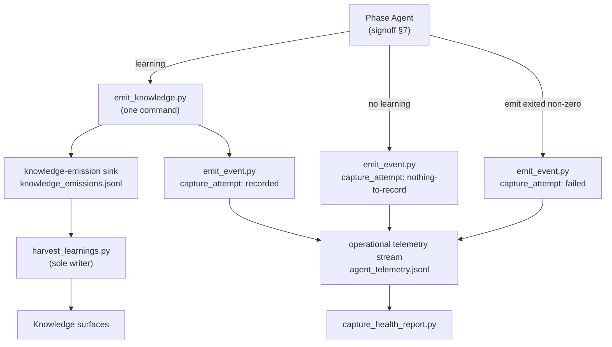

# Agent Knowledge System

Lookup reference for how a learning an agent captures becomes a record, what the
agent does when it has nothing to record or capture fails, and which step writes
the learning to its knowledge surface. The write model is ADR-034 (Knowledge Write
Ownership): an agent emits one record through one helper, and the harvester is the
sole writer. ADR-034 section 5 recorded the earlier version of this document as
describing the superseded Option A pipeline; this revision is that amendment.

---

## Architecture Overview



Both streams are declared in `.leafcutter/config/knowledge_sink.json` and share one
durable `operational_log_root` (ADR-069). `SKILL.md` files are portable templates
synced from upstream and receive no project-specific learnings; a skill's
project-specific learnings go to its co-located `PROJECT_CONTEXT.md` (filename all
uppercase with an underscore).

---

## §1 What an Agent Does at the Capture Step

The capture step is `signoff` §7 (`templates/skills/signoff/SKILL.md`). It runs
after the atomic sign-off write and asks one question: did the agent learn
something future-it would have needed at the start. The step is mandatory; the
agent's whole obligation is one command per branch below. The agent does not
classify the learning, pick a destination surface, or write to one.

| Branch | Command the agent runs | Writes to |
|---|---|---|
| Learning to record | `scripts/knowledge/emit_knowledge.py --agent … --component … --destination … --entry-kind … --text '…'` | Knowledge-emission sink; the helper then writes one `recorded` capture attempt. |
| No learning | The `Nothing-to-record capture attempt` command in `templates/skills/agent-telemetry/SKILL.md` | One `nothing-to-record` capture attempt on the telemetry stream. No knowledge record. |
| Capture could not complete | The `Failed capture attempt` command in `templates/skills/agent-telemetry/SKILL.md`, run only when the `emit_knowledge.py` command exited non-zero | One `failed` capture attempt on the telemetry stream, with the missing target. |

When the learning cannot be classified, the agent passes
`--entry-kind unclassified --destination "(unrouted)"`; the helper records that
pair as given and the harvester leaves the record unrouted.

`route-learning` and `capture-learning` are retired names (ADR-034 §2 item 3).
Neither exists under `templates/skills/` and no agent loads either. The classifier
`route-knowledge` (`templates/skills/route-knowledge/SKILL.md`) serves the
`remember this` request, not this step.

---

## §2 The Knowledge Record

Source: `scripts/knowledge/emit_knowledge.py`. One JSON object per line, written by
the helper; an agent never composes it by hand. `text` is the single field that
carries content; every other field is descriptive.

| Field | Type | Required of a producer | Purpose |
|---|---|---|---|
| `event` | string | Yes | Always `knowledge_captured`. Identifies the record type on a stream. |
| `timestamp` | string | Yes | ISO-8601 UTC time of emission. Part of the record's idempotency identity. |
| `agent` | string | Yes | Name of the emitting agent. |
| `component` | string | Yes | Component the learning concerns. |
| `destination` | string | Yes | Path of the knowledge surface the learning belongs on, or `(unrouted)`. |
| `entry_kind` | string | Yes | Kind of learning, from `config/entry_kind_vocabulary.json`, or `unclassified`. Selects the routing rule. |
| `text` | string | Yes | The learning body, as written by the agent. The only content field. |
| `ticket` | string | No | Ticket path, when the agent has one. Metadata only: no consumer keys, groups, counts or deduplicates on it. |

Seven fields are required of a producer. `ticket` is the single optional field and
is omitted by the v3 AC-authoring agents, which run outside a ticket.

### Compatibility rule

`text` is required of a producer and optional to a consumer. A reader accepts a
record without `text`. The 28 records emitted before the field existed carry six
fields (`event`, `timestamp`, `agent`, `component`, `destination`, `entry_kind`)
and are valid records. A record without usable `text` is classified
**ineligible to write**, not invalid: `_is_no_learning_text` in
`scripts/knowledge/harvest_learnings.py` returns true for `text` that is absent,
`null`, not a string, blank after whitespace normalisation, or equal to the
`[<entry_kind>] Learning from <ticket>` placeholder. Eligibility is specified in §5.

### Helper refusals

| Condition | Result |
|---|---|
| `--text` empty, or only restating the record's own agent, component, destination, entry_kind or ticket | Nothing appended; reason on stderr; one `nothing-to-record` capture attempt; exit `0`. |
| `entry_kind` outside the vocabulary (and not `unclassified`) | Nothing appended; candidates named on stderr; no capture attempt; exit `0`. |
| Sink declaration absent, unusable or stale | Nothing created; warning on stderr; exit `0`. |
| Append to the sink fails (`OSError`) | Warning naming the sink; one `failed` capture attempt with `missing_target` set to the sink path; exit `0`. |

---

## §3 Capture Attempts and Where Failures Are Recorded

A capture attempt is a `capture_attempt` record on the **operational telemetry
stream**, not the knowledge-emission sink. The two are separate streams declared
side by side in `.leafcutter/config/knowledge_sink.json` (keys
`operational_telemetry_stream` and `knowledge_emission_sink`); both sit directly
under the declared `operational_log_root` (ADR-069). Telemetry is written by
`templates/skills/agent-telemetry/scripts/emit_event.py` and nothing else writes
it (ADR-034 Amendment 2).

| Outcome | Written by | Meaning |
|---|---|---|
| `recorded` | `emit_knowledge.py`, after a successful append | A knowledge record reached the sink. Agents never write this. |
| `nothing-to-record` | The agent, or the helper on a contentless `--text` | The capture step ran and found no learning. |
| `failed` | The agent after a non-zero helper exit, or the helper on a failed append | The capture path broke. Carries `missing_target`, the path that could not be reached or run. |

A helper that exits `0`, even with a warning, handled its own failure, so the agent
adds no record. Each failure leaves at most one `failed` attempt. If
`agent-telemetry/SKILL.md` or its script cannot be read, no record is possible and
the failure stays on stderr and in the agent's sign-off comment.

### Capture-health report

`scripts/knowledge/health/capture_health_report.py` is the reader of these records
(ADR-034 Amendment 3). It counts attempts, not agent runs, over a half-open window
and gives one verdict per period.

| Verdict | Meaning |
|---|---|
| `no-run-reached-the-step` | No capture attempt was recorded in the period. |
| `capture-path-broken` | At least one `failed` attempt. |
| `learnings-recorded` | Attempts recorded learnings and none failed. |
| `nothing-to-record` | Every attempt found nothing to record. |

```bash
python3 scripts/knowledge/health/capture_health_report.py --since 2026-10-01 --until 2026-11-01
```

`--since` and `--until` are required; `--stream` overrides the telemetry stream.
The report reads only the telemetry stream. When it cannot locate the stream it
exits non-zero and prints no verdict.

---

## §4 Routing: Manual Invoke Today, Wired on Some Paths

Writing a record to its surface is the harvester's job, run through the
`knowledge-harvester` agent or `scripts/knowledge/harvest_learnings.py`. Emitting a
record does not write the learning to its surface. Whether routing runs without
anyone invoking it depends on the completion path:

- **Manual invoke.** Run the harvester by hand. This is the only route on any path
  not listed below, and for records emitted after a path's routing step has read the
  sink (those wait for the next carrying run).
- **Wired.** `fast-lane-ship.js`, `quick-fix.js` and `build-feature.js` dispatch a
  routing step before their commit; the `ticket-supervisor` drive of `build-epic.js`
  does so per ticket. `build-ticket.js` and `finalize-feature.js` do not.

The criterion that owns the trigger is `INF-700a`
(`docs/acceptance-criteria/infrastructure/INF-400-agent-learning/INF-700a.yaml`).
The authority for the wired and excluded lists is the `knowledge_routing_wiring`
section of `config/guardrail_gates.yaml`; the step's report and `--status` answer
are in [Knowledge Routing Step](../reference/knowledge-routing-step.md). A captured
learning on a path that does not carry the step does not reach its surface until
someone runs the harvester.

---

## Sequence Diagram

The capture path end to end, as one sequence diagram, is
[Knowledge Capture Path — Sequence Diagram](diagrams/c3-038-knowledge-capture-path-sequence.md).
It shows the success, cannot-complete and nothing-to-record branches of §1 and §3,
and marks where the agent's obligation ends and the routing step of §4 begins.

<!-- Doc Links:
- docs/architecture/diagrams/c3-038-knowledge-capture-path-sequence.md
Doc Links end: read by check_doc_links.py -->

---

## §5 Write Eligibility and the Waiting Count

### Eligibility rule

A knowledge record is eligible to be written only if it carries non-empty
`text`. A record without `text` — absent, `null`, or blank after whitespace
normalisation — is **ineligible**, not deferred, and is **not outstanding**.
This is a rule over a property of the data (`_is_no_learning_text`,
`scripts/knowledge/harvest_learnings.py`), not a named exception for one
corpus: a different textless body in a future install gets the same
treatment with no change. The check runs before `entry_kind` routing on
every harvest, so an ineligible record never lands in `skipped_unknown` on
that account. See **Disposition** below for the body this rule governs today.

### The waiting count

The waiting count ("outstanding") is the number of records carrying
non-empty `text` not yet written to their destination. Exactly two things
zero out a record's contribution: **no text** (ineligible, above), or
**already written** (hashed into the idempotency state). No floor, cap, or
exclusion by age, agent, `entry_kind`, or destination adjusts it — a record
that is unroutable but text-bearing still counts. This counts **records**,
never agent runs: do not conflate it with the capture-health report's
reached / recorded / failed figures, which count agent invocations reaching
the sign-off capture step — a different denominator, a different question.

### Exit codes (`harvest_learnings.py`)

| Code | Meaning |
|---|---|
| `0` | Clean — nothing outstanding, no write failure. |
| `1` | Sink unreadable, or the build-time sink declaration is stale. |
| `2` | State file corrupt. |
| `3` | Unroutable records remain (`skipped_unknown` > 0). |
| `4` | A destination write failed and/or state could not persist — outranks `3`. |

A run over the retained corpus below returns `0` — the steady-state form of
"nothing outstanding," not a special case coded around this corpus.

### Disposition: the 2026-08-26 retained corpus

28 `knowledge_captured` records, emitted 2026-06-16 through 2026-08-12, sit
in `debugging/logs/agent_telemetry.jsonl` (a byte-identical copy is tracked
at `tests/fixtures/harvest_learnings/agent_telemetry_33_lines.jsonl` for a
reader with no live install). Each carries exactly six fields — `event`,
`timestamp`, `agent`, `component`, `destination`, `entry_kind` — and no
`text`; under the rule above, all 28 are ineligible and none is outstanding.

The 28 name 10 distinct destinations. Nine exist, holding real content from
roughly 3.5 KB to over 23 KB at last check and still growing (one,
`docs/acceptance-criteria/ac-store/PROJECT_CONTEXT.md`, is now well past
23 KB — re-verify on read). The tenth,
`memory/feedback_itpo_bo1700_worktree_gate_parity.md`, has never existed in
git history.

Resolving the 28 wrote nothing anywhere: no destination opened, no directory
created, the stream unchanged. Nothing was moved, marked, archived, or
watermarked. Because no per-record exemption is stored, revisiting needs no
un-marking step — real `text` on one of the 28, or a rule change, makes it
outstanding again next run, with no state to reset.

**Default-sink note.** `harvest_learnings.py` leaves `--sink` unset by
default; `scripts/knowledge/sink_resolution.py`'s `resolve_default_sink()`
prefers a build-time declaration (`.leafcutter/config/knowledge_sink.json`, key
`knowledge_emission_sink`) and otherwise falls back to the relative literal
`debugging/logs/knowledge_emissions.jsonl`. Do not read that literal as "the
sink": a built install's declaration is the sink, and in this install it names
`knowledge_emissions.jsonl` under the declared `operational_log_root`, a file
that now exists beside `agent_telemetry.jsonl`. The 28 predate the emitter-side
repoint (`signoff` §7, `INF-400c-4`) and remain on the stream they were
actually written to; they are addressed by the eligibility rule above, not by
a sink repoint or recovery — no drain of this body is pending.

---

## References

- **[Agent Knowledge Plane](agent_knowledge_plane.md)** — the injection-side
  complement to this document: enumerates all 11 channels through which
  agents receive context at invocation time (pre-execution knowledge injection).
- [ADR-034: Knowledge Write Ownership](adrs/ADR-034-knowledge-write-ownership.md) — the decision this document follows; Amendments 1-3 are under `adrs/amendments/ADR-034/`.
- [ADR-069: Durable log root](adrs/ADR-069-durable-log-root-for-workspaces.md) — the declaration of both streams.
- `templates/skills/signoff/SKILL.md` §7 — mandatory knowledge-capture step and the normative record shape.
- `templates/skills/agent-telemetry/SKILL.md` — the `Nothing-to-record capture attempt` and `Failed capture attempt` commands.
- `scripts/knowledge/emit_knowledge.py` — the emit helper that writes the knowledge record.
- `scripts/knowledge/health/capture_health_report.py` — the capture-health report.
- `templates/skills/README.md` — `PROJECT_CONTEXT.md` pattern and **naming convention** (§Naming convention): filename MUST be `PROJECT_CONTEXT.md` (all uppercase, underscore); lowercase `project_context.md` is incorrect.
- [Description Field Convention](../reference/description-field-convention.md) — the required `description:` frontmatter field (moved out of this document).
- [Knowledge Graph Visualization](../reference/knowledge-graph-visualization.md) — `visualise_knowledge_graph.py` output and invocation (moved out of this document).
- `docs/reference/workflow-constraints.md` §Removed Legacy Agents — canonical list of seven removed agent IDs that must not appear as dispatch targets in any workflow, skill, or command template (AC ACD-1100a-3).
- [Knowledge Routing Step](../reference/knowledge-routing-step.md) — where the routing step runs, what its report and `--status` answer mean to a caller.
- `docs/acceptance-criteria/infrastructure/INF-400-agent-learning/INF-700c-2.yaml` (and its `-i`/`-ii` children) — the eligibility rule, disposition, and waiting-count definition §5 above records.
