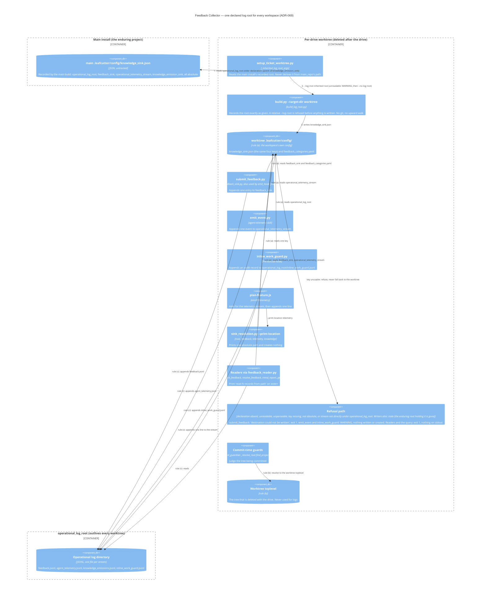

# Feedback Collector

## Overview

The Feedback Collector captures structured quality signals from phase agents and supervisors via the `submit_feedback.py` script. Each signal records a category, tags, and a one-sentence note, keyed to a ticket path and agent phase.

## Responsibilities

- Accept feedback submissions from phase agents during sign-off
- Assign unique `feedback_id` values (e.g. `fb_2026-06-08_a1b2c3d4`)
- Persist entries to the install's declared `feedback_sink` (see below)
- Support aggregation and retrospective queries via `aggregate.py`

## Where entries are written and read

The sink is the `feedback_sink` value in the build-time declaration
`<output_root>/config/knowledge_sink.json`, i.e. `<operational_log_root>/feedback.jsonl`.
Every worktree of an install shares it, and it outlives the worktree
([ADR-069](../adrs/ADR-069-durable-log-root-for-workspaces.md)). How the root is chosen,
the location query, and the refusal wording are described in
[Feedback Lifecycle — Where every log is kept](../feedback-lifecycle.md#where-every-log-is-kept--one-declared-log-root-adr-069).

| Script | Role | Without an explicit path |
|---|---|---|
| `submit_feedback.py` | writer | Appends to `feedback_sink` (via `feedback_sink.py`). If the declaration is unusable, prints one `destination could not be written` line, exits 1, and creates nothing. |
| `emit_hook_finding.py` | writer (through `submit_feedback.py`) | Same as `submit_feedback.py`. |
| `aggregate.py`, `list_tags.py`, `link_feedback.py`, `resolve_feedback.py`, `trend_report.py`, `generate_health_report.py` | readers | Read `feedback_sink` (and `operational_telemetry_stream` where used) through `feedback_reader.py`. Print `read N records from <path>` on stderr. Exit 1 with no stdout when the declaration is unusable. |

An explicit `--jsonl` is still honoured. `link_feedback.py` and `resolve_feedback.py` hold
the same exclusive lock as `submit_feedback.py` for the whole read-modify-write.
`feedback_categories.yaml` is still resolved separately, from the script's own
`.leafcutter/config/` (rule (a)).

## Component diagram — where a drive's logs end up

The build records one enduring log location. The per-drive worktree inherits it from the
main install, and every writer and reader of the operational log directory reaches that
one location. The diagram shows the three resolution rules as separate edges. No shared
resolver serves them.

No L2 container doc covers the feedback collector yet, so this diagram is marked
`root: true`. The decision behind it is [ADR-069](../adrs/ADR-069-durable-log-root-for-workspaces.md).

How to read it:

- **Rule (a), configuration.** Every script finds the declaration and
  `feedback_categories.yaml` in its own workspace's `.leafcutter/config/`
  (`_find_config_root()`, and the `parents[N]` arithmetic in `emit_event.py` and
  `inline_work_guard.py`). The file is found by rule (a). Only the value it holds is rule (c).
- **Rule (b), guards.** Commit-time guards resolve to the worktree toplevel through
  `_resolve_root.find_project_root()`. That tree is deleted with the drive, so the guard
  resolver is never reused for logs.
- **Rule (c), logs.** The paths that writers append to and readers read are the absolute values
  recorded in the declaration. A stream is usable only when the declaration also records an
  absolute `operational_log_root` and the stream sits directly under it
  (`sink_resolution.read_usable_stream`; `emit_event.py` carries an inline copy).
- **Stale versus first write.** A writer refuses as stale only when the enduring root that holds
  `operational_log_root` is gone: its parent, or the project above `debugging`
  (`sink_resolution.enduring_root_exists`). A log directory that is simply missing under a live
  root is a fresh install, and the first write creates it.
- **`--no-log-root`.** When the bootstrap cannot read the main install's root, the build records
  an empty declaration: `build_log_root.declaration_values` returns `{}`, so no root, sink or
  stream is recorded. Every writer then refuses. `submit_feedback.py` prints `destination could
  not be written`. `emit_event.py` and `inline_work_guard.py` warn and write nothing.
  `plan-feature.js` gets no stream from `--print-location telemetry`. The harvester and every
  `--print-location` query refuse too. Nothing is written into the worktree. A bare
  `build.py --target-dir <worktree>` with neither flag is different: it records the worktree's
  own `debugging/logs` for all four keys, a root that is deleted with the worktree.

Related: [Worktree Manager](worktree-manager.md) (the bootstrap), [Feedback Lifecycle](../feedback-lifecycle.md) (what happens to entries after they are written).

## Entry Points

- `scripts/feedback/submit_feedback.py` — main submission script
- `scripts/feedback/feedback_sink.py` — resolves the declared sink or builds the refusal line
- `scripts/feedback/feedback_reader.py` — shared reader resolution and the `read N records` line
- `scripts/feedback/aggregate.py` — aggregation and reporting
- `scripts/feedback/list_tags.py` — tag discovery utility
- `scripts/feedback/link_feedback.py` — links feedback entries to tickets
- `.leafcutter/scripts/knowledge/sink_resolution.py --print-location feedback` — prints the sink without writing

## Integration

Every phase agent calls `submit_feedback.py` before appending their sign-off comment. The returned `feedback_id` appears as the first line of the comment body per the signoff skill §2a protocol. Shipped prompts no longer pass a `--jsonl` path of their own (INF-500d-4-vi).
