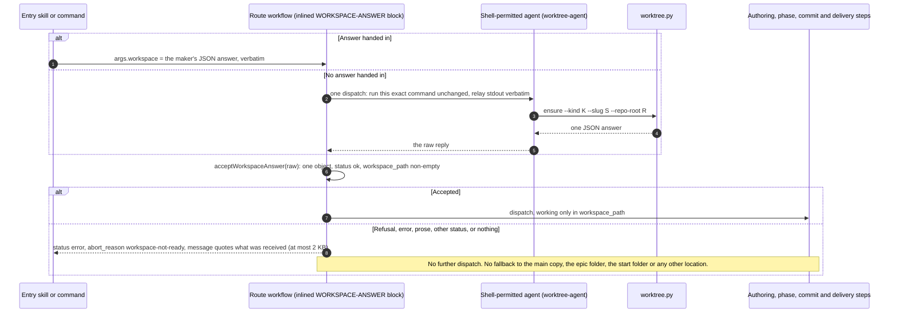

# Sequence — every caller stops on anything but a ready answer (BO-4300c-3)

Parent: [Worktree Manager](worktree-manager.md). This page was split out of the parent
component page to keep it under the document length limit; no content was dropped.

Every route workflow that needs a workspace (build-epic, build-feature, build-ticket,
quick-fix, plan-feature, fast-lane-ship, finalize-feature) applies one acceptance predicate
to the maker's answer before it does anything else. The predicate lives once, in
`templates/workflows-js/_shared/workspace-answer.js`. The workflow build phase
(`scripts/build_phases_workflows.py`, using `scripts/build_workflow_inline.py`) copies it
between the `WORKSPACE-ANSWER` marker pair of each workflow template, because workflow
bodies run in the E2 engine with no `require`
([ADR-030](../adrs/ADR-030-dual-engine-workflow-support.md)). The build refuses a template
whose marker pair already holds text, so no workflow carries a hand-edited copy.

An answer is accepted only when it is one JSON object, its `status` is `ok`, and
`workspace_path` is a non-empty string. A refusal, an error, prose, an object whose status
is neither `ok` nor `refused`, and no answer at all are all rejected the same way.

How to read it:

- **One predicate, no fallback.** `acceptWorkspaceAnswer` returns either the accepted
  answer and its `workspace_path`, or a reason plus the received text. `workspaceStop`
  turns a rejection into the run's only result. The old fallbacks that treated "no
  workspace" as normal were removed: the null-worktree mode of plan-feature, build-epic's
  caller, probe or epic-path fallback, finalize-feature's `unknown` root, fast-lane-ship's
  `gitReportedPath || claimedWorktreePath`, and build-ticket's unchecked
  `args.worktree_path`.
- **The failure quotes what arrived.** The message carries the received text once,
  truncated to 2 KB, so the reader sees the maker's own refusal or the stray prose.
- **Nothing runs after the workspace step on a rejection.** The test
  `unit_tests/build_orchestration/test_bo_4300c_3.py` runs each deployed workflow under
  the E2 harness with the maker's answer replaced in turn by each of the five hostile
  answers, and asserts on the recorded dispatch list: it ends at the workspace step and
  names no location that did not come from an `ok` answer.
- **Parity is tested on the deployed copies.** The text between the markers must equal the
  source block byte for byte in every deployed workflow, and every workflow that reads
  `args.workspace` or records a workspace dispatch must carry the block.
- **Entry skills stop earlier.** A skill that runs the maker stops on a non-zero exit
  (BO-4300a-1-ib). This sequence covers the workflow bodies.
