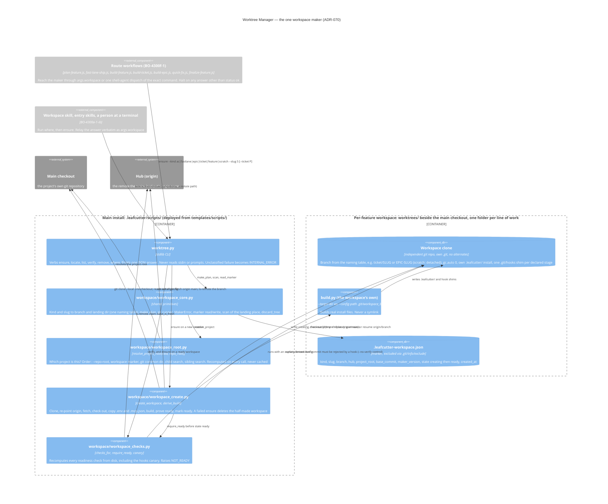

# Worktree Manager

## Overview

The Worktree Manager provides isolated branch environments for epic and ticket development using git worktrees. Each epic gets its own worktree so parallel tickets can proceed without cross-branch contamination.

## Responsibilities

- Create and register git worktrees for new epics
- Sweep orphan processes left behind after worktree teardown
- Provide the commit serialization lock (`epic-commit-lock`) used by ticket-supervisor

## Entry Points

- `scripts/worktree/sweep_processes.py` — orphan process cleanup
- `scripts/setup_ticket_worktree.py` — worktree provisioning script

## Component diagram — the one workspace maker (ADR-070)

One maker makes every workspace. Each route runs one command and gets one JSON answer
back. The maker's source is `templates/scripts/worktree.py`; the build deploys it to
`<install>/.leafcutter/scripts/worktree.py`. Its helpers live in the `workspace/` package
beside it, and each helper has its own named deploy entry. A workspace is a hardlinked
local clone of the main checkout. Its `origin` points at the hub, it starts from
`origin/main` as fetched when the request is made, and it gets its own install from its own
`build.py`. The marker file inside it is the registry. The decision is
[ADR-070](../adrs/ADR-070-single-workspace-maker-and-resolver.md).

`root: true`: no L2 container doc covers the workspace lifecycle yet. Decision record:
[ADR-070 — One Workspace Maker and One Project-Root Resolver](../adrs/ADR-070-single-workspace-maker-and-resolver.md).

How to read it:

- **One entry, one answer.** `ensure` is the only verb that creates anything. `locate`,
  `list` and `verify` only read. `remove` refuses a workspace with unsaved work unless
  `--discard` is given, and `--delete-remote-branch` also deletes the branch on the hub.
  Every verb prints exactly one JSON object. A caller takes the workspace location only
  from `workspace_path` (alias `worktree_path`) in that answer, and the ticket location
  only from `ticket_path_in_worktree` when it passed `--ticket`.
- **The marker is the registry.** `list` and `locate` scan the markers in the landing place
  and never call `git worktree list`. An `ensure` on a workspace whose marker is not
  `ready` fails with `WORKSPACE_INCOMPLETE`.
- **Readiness is measured, not assumed.** `workspace_checks` returns the same set of check
  names for every route: an independent repository, not the main checkout, the same
  project, the expected branch, not a protected branch, a fresh base, an install, a clean
  tree, a real `.pre-commit-config.yaml`, a hook file for each declared stage, and
  `hooks_canary_rejected`. The canary commits a known-bad file with the working directory
  set to the workspace, never with `git -C`. A rejection counts as proof only if a control
  commit made with `--no-verify` succeeds. The check never runs on a tree that holds work.
- **The callers are not migrated yet.** The route workflows shown on the left move to the
  maker under BO-4300f-1. Until BO-4300f-2 retires it, `setup_ticket_worktree.py` (listed
  under Entry Points above) is still a second way to make a workspace.

## Safety Constraints

Per building-epics §1.4, worktrees MUST NOT be closed until all sub-tickets are done. The All-Tickets-Done gate (§1.4.1) enforces this by counting open tickets before allowing `worktree-agent` to run.

The caller that invokes `scripts/setup_ticket_worktree.py` (`templates/workflows-js/plan-feature.js`'s
authoring-worktree creation step) MUST resolve it to an absolute, repository-anchored path
rather than a session-cwd-relative `.leafcutter/` one — otherwise, under the
[ADR-001](../adrs/ADR-001-self-hosting-boundary.md) self-hosting layout, the deployed copy
outside the repository can run instead of the copy inside it. See
[`docs/known-issues/ac-driven-dev.md`](../../known-issues/ac-driven-dev.md) → `KI-ACD-004`
for the reproduction and the fix (`buildRepoAnchoredResolutionCommand` /
`resolveRepoAnchoredScriptPath` in `plan-feature.js`), and
[`docs/architecture/components/ac-driven-dev.md`](ac-driven-dev.md) for the calling
component.

`scripts/setup_ticket_worktree.py` additionally hardens itself, independent of that
caller-side fix, against being invoked from outside any git repository at all (AC
`ACD-2100a-2`). Its `create-only` subcommand resolves the repository it operates on with
an ordered contract implemented by `_resolve_repository_with_search_fallback()`:

1. An explicit `--repo-root` supplied on the command line always wins outright and never
   consults the anchor or the search.
2. Otherwise the script's own on-disk anchor (`_git_toplevel()`) remains the first choice,
   unchanged for every caller that already works.
3. Only when the anchor fails does a bounded search run
   (`_search_immediate_subdirectory_repos()`) — over the *immediate* subdirectories of the
   process's current working directory only, never walking upward past it and never
   following a symlink out of it. The search returns its full candidate set, so an
   ambiguous layout (zero or more than one candidate) is representable and raised as an
   error rather than silently guessed.

A search-based resolution always announces itself on the diagnostic stream at WARNING
level, naming the repository it selected and stating that the selection came from a
search rather than from the script's own location — a silent fallback would be
indistinguishable from the anchor having worked and would leave a future
wrong-repository incident undiagnosable. See
[`docs/known-issues/ac-driven-dev.md`](../../known-issues/ac-driven-dev.md) → `KI-ACD-004`
("Fix landed 2026-08-31 (`ACD-2100a-2`)") for the failure this complements. The
`create-ac-worktree` and `create-fastlane-worktree` subcommands still call the bare
`_git_toplevel()` anchor with no fallback and are a known related gap outside this AC's
scope.

## Log root inherited from the main install (ADR-069)

A worktree is deleted when its drive ends, so its logs must not live in it. The bootstrap
(`_bootstrap` step 5 in `scripts/setup_ticket_worktree.py`) runs the worktree's own
`build.py --target-dir <worktree>` and hands it the log root the main install already
recorded. AC [INF-500d-4-iii](../../acceptance-criteria/infrastructure/INF-500-operational-observability/INF-500d-4-iii.yaml);
decision: [ADR-069](../adrs/ADR-069-durable-log-root-for-workspaces.md).

- **Read, never derived.** `_inherited_log_root_args()` reads
  `<main_repo>/.leafcutter/config/knowledge_sink.json` and takes `operational_log_root`, or,
  for an older declaration, the parent directory of `knowledge_emission_sink`. It never
  computes a root from `main_repo`'s own path, and it does not call git or walk upward.
  The build is called with `--log-root <that root>`. `build_log_root.py` records it exactly
  as given. A relative `--log-root` is refused before anything is written.
- **Unreadable main declaration.** If the file is absent, unreadable, keyless or names a
  relative root, the bootstrap prints a `WARNING` naming the path it tried and saying that
  logs written in this worktree will not survive its removal. It then passes
  `--no-log-root`, so the build records an empty declaration (`{}`) and every writer refuses.
  No declaration names the worktree's own root.
- **Older worktree `build.py`.** A branch whose `build.py` predates the flags exits 2 with
  `unrecognized arguments`. The bootstrap retries once without the flag and warns that the
  worktree has no durable log root. This case does not raise `missing_config`.
- **Symlinked `.leafcutter`.** When the worktree ends up with no `.leafcutter` of its own,
  `_establish_pre_commit_config()` links the main install's `.leafcutter`. Through that link
  the worktree reads the main install's declaration, which names the same root.
- **Three rules stay separate.** Configuration still resolves to the worktree's own
  `.leafcutter/config` and commit guards to the worktree toplevel. Only the value inside the
  declaration points at the enduring root.

A bare `build.py --target-dir <worktree>` run by hand, with neither flag, still declares
the worktree's own `debugging/logs`. It prints the operational log root it declared and a
NOTE that this working directory gets its own, second sink (INF-400c-4-v). Writers and readers
of the shared directory are described in
[Feedback Collector](feedback-collector.md#component-diagram--where-a-drives-logs-end-up)
and [Feedback Lifecycle](../feedback-lifecycle.md#where-every-log-is-kept--one-declared-log-root-adr-069).
