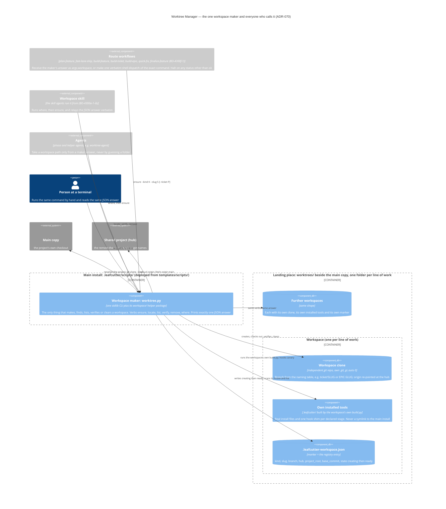

# Worktree Manager

## Overview

The Worktree Manager gives every separate line of work (an epic, a ticket, an AC-authoring
session, a fast-lane build) its own workspace. One maker makes them all: `worktree.py`. A
workspace is a per-feature clone of the main copy, not a `git worktree`. It has its own
`.git`, its own branch, its own installed tools and its own marker file. Because each
workspace is an independent repository, parallel lines of work cannot touch each other's
branch, index or object store. The decision is
[ADR-070](../adrs/ADR-070-single-workspace-maker-and-resolver.md); the clone topology is
decision 1 of [ADR-018](../adrs/ADR-018-agent-isolation-topology.md).

## Responsibilities

- Make, find, list, verify and clear workspaces through one maker, `worktree.py`, which
  prints exactly one JSON answer per call
- Resolve the project root the same way for every caller (`workspace_root.py`)
- Prove each workspace ready by measuring it from disk, including a hooks canary, before
  marking it `ready`
- Keep the registry as one marker file inside each workspace, never in a shared list
- Sweep orphan processes left behind after a workspace is cleared
- Provide the commit serialization lock (`epic-commit-lock`) used by ticket-supervisor

## Entry Points

- `scripts/worktree.py` (source `templates/scripts/worktree.py`; deployed to
  `<install>/.leafcutter/scripts/worktree.py`): the workspace maker. Verbs `ensure`,
  `locate`, `list`, `verify`, `remove`, `where`. This is the primary entry point and the
  only one the decided topology allows for making, finding or clearing a workspace.
- `scripts/worktree/sweep_processes.py`: orphan process cleanup.
- `scripts/setup_ticket_worktree.py`: **legacy**. The old git-worktree provisioning
  script. `worktree-agent` and the `feature` skill still call it as of 2026-10-14. It is
  retired under BO-4300f-2 and must not be used by new callers.

The maker names where a requested ticket lives inside the workspace and refuses when the ticket is not on the workspace's base; see [Ticket Location Fields](../../reference/workspace-maker-answers-and-codes.md#ticket-location-fields) and the `TICKET_NOT_ON_BASE` / `OCCUPIED` codes in the same reference.

## Component diagram — the one workspace maker (ADR-070)

One maker makes every workspace. Each route runs one command and gets one JSON answer
back. The maker's source is `templates/scripts/worktree.py`; the build deploys it to
`<install>/.leafcutter/scripts/worktree.py`. Its helpers live in the `workspace/` package
beside it, and each helper has its own named deploy entry. A workspace is a hardlinked
local clone of the main checkout. Its `origin` points at the hub, it starts from
`origin/main` as fetched when the request is made, and it gets its own install from its own
`build.py`. The marker file inside it is the registry. The decision is
[ADR-070](../adrs/ADR-070-single-workspace-maker-and-resolver.md).

`root: true`: no L2 container doc covers the workspace lifecycle yet, so this diagram has no parent tier.

Decision record:
[ADR-070 — One Workspace Maker and One Project-Root Resolver](../adrs/ADR-070-single-workspace-maker-and-resolver.md).
Isolation topology (per-feature clones, `gc.auto=0`):
[ADR-018 — Agent Isolation Topology](../adrs/ADR-018-agent-isolation-topology.md).

Every arrow into the landing place starts at the maker. No caller has an arrow of its own
to a workspace, to the main copy or to the hub, so the diagram shows no second way to make,
find or clear a workspace. The maker is drawn as one component; its helper modules are
internal to it:

| Module | Role inside the maker |
|---|---|
| `worktree.py` | CLI entry: parses the verb, prints one JSON answer, never reads stdin or prompts; an unclassified failure becomes `INTERNAL_ERROR` |
| `workspace/workspace_core.py` | One naming table (kind and slug to branch and folder), `make_plan`, git runner, `MakerError`, marker read/write, landing-place scan, `discard_tree` |
| `workspace/workspace_root.py` | `resolve_project_root`: `--repo-root`, workspace marker, git common dir, child search, sibling search; recomputed on every call |
| `workspace/workspace_create.py` | Clone, re-point origin, fetch, check out, copy `.env` and `.mcp.json`, build, prove ready, mark ready; a failed `ensure` deletes the half-made workspace |
| `workspace/workspace_checks.py` | Recomputes every readiness check from disk, including `install_paths_regular` and the hooks canary; raises `NOT_READY` |

How to read it:

- **One entry, one answer.** `ensure` is the only verb that creates anything. `locate`,
  `list` and `verify` only read. `remove` refuses a workspace with unsaved work unless
  `--discard` is given, and `--delete-remote-branch` also deletes the branch on the hub.
  Every verb prints exactly one JSON object. A caller takes the workspace location only
  from `workspace_path` (alias `worktree_path`) in that answer, and the ticket location
  only from `ticket_path_in_worktree` when it passed `--ticket`.
- **The marker is the registry.** `list` and `locate` scan the markers in the landing place
  and never call `git worktree list`. An `ensure` on a workspace whose marker is not
  `ready` fails with `WORKSPACE_INCOMPLETE`.
- **Readiness is measured, not assumed.** `workspace_checks` returns the same set of check
  names for every route: an independent repository, not the main checkout, the same
  project, the expected branch, not a protected branch, a fresh base, an install, a clean
  tree, a real `.pre-commit-config.yaml`, `install_paths_regular` (no link anywhere in the
  install or protections, see [No links, so no link permission needed](#no-links-so-no-link-permission-needed)),
  a hook file for each declared stage, and
  `hooks_canary_rejected`. The canary commits a known-bad file with the working directory
  set to the workspace, never with `git -C`. A rejection counts as proof only if a control
  commit made with `--no-verify` succeeds. The check never runs on a tree that holds work.
- **The diagram is the decided topology; the callers are not all migrated yet.** The route
  workflows move to the maker under BO-4300f-1, and the workspace skill lands under
  BO-4300a-1-ib. As of 2026-10-14, `worktree-agent` and the `feature` skill still call
  `setup_ticket_worktree.py`. Until BO-4300f-2 retires that script it remains a second way
  to make a workspace in the code, even though the diagram, by decision, draws none.

## Safety Constraints

Per building-epics §1.4, a workspace MUST NOT be closed until all sub-tickets are done. The All-Tickets-Done gate (§1.4.1) enforces this by counting open tickets before allowing `worktree-agent` to run.

What the maker itself guarantees:

- **Nothing half-made survives.** A failed `ensure` deletes the workspace it was making, so a
  retry starts clean. An `ensure` on a workspace whose marker is not `ready` fails with
  `WORKSPACE_INCOMPLETE`.
- **No protected branch, no stale base.** Readiness fails on a protected branch, and on a base
  older than the hub's `origin/main` unless `--allow-stale-base` was given. An unreachable hub
  is `FETCH_FAILED` without that flag.
- **Unsaved work is never discarded silently.** `remove` refuses a workspace with unsaved
  work unless `--discard` is given.
- **No symlinks.** The workspace gets real install files from its own `build.py`. It never
  links to the main install, so a build in one workspace cannot rewrite another's tools.
  This is measured, not assumed: see the next section.
- **No guessed paths.** Every caller takes the workspace path from the maker's JSON answer.
  The project root is recomputed on every call by `workspace_root.py`.

### No links, so no link permission needed

Source AC: `BO-4300b-4`. On Windows, creating a symbolic link needs a permission an
ordinary user often lacks. The `ensure` path creates no link anywhere, so a user without
that permission still gets a workspace answered `ready`. The answer and the workspace are
the same as on a machine where links are permitted. The build's shim installer
(`install_shims` in `scripts/build_helpers.py`) takes its copy path.

- **The check.** `install_paths_regular` in `workspace/workspace_checks.py` walks the
  `.leafcutter` install tree, `.pre-commit-config.yaml` and `.git/hooks`. It uses `lstat`
  and never follows a link. A symlink or a Windows junction (reparse point) anywhere in
  those paths makes the check false, `require_ready` raises `NOT_READY`, and the half-made
  workspace is deleted like any other failed `ensure`. `precommit_config_present` also
  rejects a symlinked `.pre-commit-config.yaml`.
- **The protections still protect.** `hooks_canary_rejected` still has to pass, so a commit
  of a known-bad file inside a link-free workspace is rejected by its installed hook.
- **`workspace_create.py` needed no change.** It already makes no links; the readiness
  check is what turns that property into a recorded, per-workspace fact.
- **Proof, on two arms.** Arm 1 is the `workspace-no-links-windows` job in
  `.github/workflows/ci.yml`: a `windows-latest` runner runs
  `unit_tests/build_orchestration/test_bo_4300b_4.py` with no setting changed to permit
  links. Its Windows-only tests report as skipped ("not run"), never as passed, on a runner
  that does hold the permission. Arm 2 runs on every platform: the deployed maker is run as
  a separate process with a `sitecustomize` that makes `os.symlink` raise, against real
  temporary git repositories and a real bare hub. The tests compare the answers of the
  link-permitted and link-denied runs after normalising paths, timestamps and shas.

### Legacy: `setup_ticket_worktree.py` (until BO-4300f-2)

The rest of this section and the next section describe the old git-worktree script. They
stay accurate for its remaining callers (`worktree-agent`, the `feature` skill) and are
removed when BO-4300f-2 retires the script. None of it applies to the maker.

The caller that invokes `scripts/setup_ticket_worktree.py` (`templates/workflows-js/plan-feature.js`'s
authoring-worktree creation step) MUST resolve it to an absolute, repository-anchored path
rather than a session-cwd-relative `.leafcutter/` one — otherwise, under the
[ADR-001](../adrs/ADR-001-self-hosting-boundary.md) self-hosting layout, the deployed copy
outside the repository can run instead of the copy inside it. See
[`docs/known-issues/ac-driven-dev.md`](../../known-issues/ac-driven-dev.md) → `KI-ACD-004`
for the reproduction and the fix (`buildRepoAnchoredResolutionCommand` /
`resolveRepoAnchoredScriptPath` in `plan-feature.js`), and
[`docs/architecture/components/ac-driven-dev.md`](ac-driven-dev.md) for the calling
component.

`scripts/setup_ticket_worktree.py` additionally hardens itself, independent of that
caller-side fix, against being invoked from outside any git repository at all (AC
`ACD-2100a-2`). Its `create-only` subcommand resolves the repository it operates on with
an ordered contract implemented by `_resolve_repository_with_search_fallback()`:

1. An explicit `--repo-root` supplied on the command line always wins outright and never
   consults the anchor or the search.
2. Otherwise the script's own on-disk anchor (`_git_toplevel()`) remains the first choice,
   unchanged for every caller that already works.
3. Only when the anchor fails does a bounded search run
   (`_search_immediate_subdirectory_repos()`) — over the *immediate* subdirectories of the
   process's current working directory only, never walking upward past it and never
   following a symlink out of it. The search returns its full candidate set, so an
   ambiguous layout (zero or more than one candidate) is representable and raised as an
   error rather than silently guessed.

A search-based resolution always announces itself on the diagnostic stream at WARNING
level, naming the repository it selected and stating that the selection came from a
search rather than from the script's own location — a silent fallback would be
indistinguishable from the anchor having worked and would leave a future
wrong-repository incident undiagnosable. See
[`docs/known-issues/ac-driven-dev.md`](../../known-issues/ac-driven-dev.md) → `KI-ACD-004`
("Fix landed 2026-08-31 (`ACD-2100a-2`)") for the failure this complements. The
`create-ac-worktree` and `create-fastlane-worktree` subcommands still call the bare
`_git_toplevel()` anchor with no fallback and are a known related gap outside this AC's
scope.

## Log root inherited from the main install (ADR-069) — legacy bootstrap

**Legacy until BO-4300f-2.** This section describes how `setup_ticket_worktree.py` hands a
worktree its log root. ADR-070 keeps the rule (a workspace inherits the main install's
durable log root through its own build). As of 2026-10-14, though, the maker's build step
(`_build` in `workspace/workspace_create.py`) passes only `--target-dir` and `--config-path`
to the workspace's `build.py`, with no `--log-root`. So a maker-made workspace does not yet
get the inherited root that the bootstrap below provides.

A worktree is deleted when its drive ends, so its logs must not live in it. The bootstrap
(`_bootstrap` step 5 in `scripts/setup_ticket_worktree.py`) runs the worktree's own
`build.py --target-dir <worktree>` and hands it the log root the main install already
recorded. AC [INF-500d-4-iii](../../acceptance-criteria/infrastructure/INF-500-operational-observability/INF-500d-4-iii.yaml);
decision: [ADR-069](../adrs/ADR-069-durable-log-root-for-workspaces.md).

- **Read, never derived.** `_inherited_log_root_args()` reads
  `<main_repo>/.leafcutter/config/knowledge_sink.json` and takes `operational_log_root`, or,
  for an older declaration, the parent directory of `knowledge_emission_sink`. It never
  computes a root from `main_repo`'s own path, and it does not call git or walk upward.
  The build is called with `--log-root <that root>`. `build_log_root.py` records it exactly
  as given. A relative `--log-root` is refused before anything is written.
- **Unreadable main declaration.** If the file is absent, unreadable, keyless or names a
  relative root, the bootstrap prints a `WARNING` naming the path it tried and saying that
  logs written in this worktree will not survive its removal. It then passes
  `--no-log-root`, so the build records an empty declaration (`{}`) and every writer refuses.
  No declaration names the worktree's own root.
- **Older worktree `build.py`.** A branch whose `build.py` predates the flags exits 2 with
  `unrecognized arguments`. The bootstrap retries once without the flag and warns that the
  worktree has no durable log root. This case does not raise `missing_config`.
- **Symlinked `.leafcutter`.** When the worktree ends up with no `.leafcutter` of its own,
  `_establish_pre_commit_config()` links the main install's `.leafcutter`. Through that link
  the worktree reads the main install's declaration, which names the same root.
- **Three rules stay separate.** Configuration still resolves to the worktree's own
  `.leafcutter/config` and commit guards to the worktree toplevel. Only the value inside the
  declaration points at the enduring root.

A bare `build.py --target-dir <worktree>` run by hand, with neither flag, still declares
the worktree's own `debugging/logs`. It prints the operational log root it declared and a
NOTE that this working directory gets its own, second sink (INF-400c-4-v). Writers and readers
of the shared directory are described in
[Feedback Collector](feedback-collector.md#component-diagram--where-a-drives-logs-end-up)
and [Feedback Lifecycle](../feedback-lifecycle.md#where-every-log-is-kept--one-declared-log-root-adr-069).
