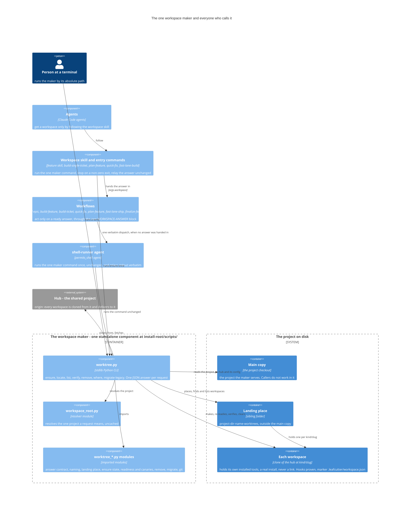

# Worktree Manager

## Overview

Every workspace is an independent, hardlinked local clone of the hub. This holds for every
kind of work: a long-running build, a single-ticket build, a quick fix, a
requirements-authoring session, a fast-lane run, an epic or a scratch session. All of them
are made, found, listed, verified and cleared through **one maker**,
`templates/scripts/worktree.py`, deployed to `<install-root>/scripts/worktree.py`
([ADR-018 Amendment 1](../adrs/ADR-018-agent-isolation-topology.md#amendment-1--2026-09-27--one-workspace-maker-hardlinked-clones-real-install-files)).
The maker runs from any folder. A caller names it by its absolute path, which
`worktree.py where` prints. Every request gets one JSON object on stdout, in the same form
whichever route asked. **The only place a caller may work is the `workspace_path` of an
`ok` answer.**

Each workspace carries a durable marker, `.leafcutter/workspace.json`, kept outside version
control. `locate`, `list` and `verify` read these markers, never `git worktree list`: no
git command lists clones.

**Naming and landing place**, as decided by the user on 2026-09-28:

- Every workspace is named `<kind>/<slug>`. Legacy spellings such as `EPIC-<Name>` are
  accepted as aliases and reach the same workspace.
- Every workspace lives in the project's sibling folder `<project-dir-name>-worktrees/`,
  outside the main copy.
- An explicit `--landing-root` moves that folder. The maker validates the override: it
  must be absolute and outside the project's working tree.
- Callers never build a location from this pattern. They take it from the answer.

## Component diagram

See also: [Workspace Request — A Caller, the Workspace Maker, and the Halt Path](../diagrams/c3-034-workspace-request-halt-sequence.md)
(sequence) and [Workspace States — What Asking for the Same Work Does in Each Situation](../diagrams/c3-031-workspace-request-states.md)
(state).

**One way in.** Every arrow that makes, finds or clears a workspace ends at `worktree.py`.
No caller clones, links, copies or deletes a workspace itself, and no other code path in
the package may do it. The former provisioning script, and the recipes that still name it,
are retired under BO-4300f-2. No new caller may be added against them.

| Caller | How it reaches the maker | What it does with the answer |
|---|---|---|
| Workflows | Use the answer handed in as `args.workspace`. Or confirm a handed-in location with one `verify` request. Or send the maker command, unchanged, in exactly one dispatch to the `shell-runner` agent (ADR-030: a workflow body cannot run a process) | One acceptance check. Anything but `ok` with a `workspace_path` ends the run before any working step ([c3-034](../diagrams/c3-034-workspace-request-halt-sequence.md)) |
| Workspace skill and entry commands | Run `ensure` once, by absolute path | Stop on a non-zero exit. On exit 0, relay the answer word for word, as `args.workspace` |
| Agents | Follow the workspace skill. The `shell-runner` agent runs only the exact command it is given | Work only inside the answer's `workspace_path` |
| Person at a terminal | `python <install-root>/scripts/worktree.py <verb> ...` | On a refusal: stop, remedy the cause the refusal names, and ask again |

## Responsibilities

- Make, find, list, verify and clear per-feature clone workspaces for every route, through
  the one maker
- Resolve the calling project with the separate, uncached resolver
  `templates/scripts/workspace_root.py`. The same request works from the project's top
  folder, from the folder above it, and from inside another workspace
- Build a real install of the tools inside every workspace, never a link to the main copy's.
  Prove that each declared hook stage rejects a canary commit there before answering `ready`
- Make asking again always safe: one request at a time per piece of work, a ready workspace
  re-readied without touching the work in it, and a half-made one finished in place
  ([c3-031](../diagrams/c3-031-workspace-request-states.md))
- Answer with the one result contract (BO-4300c-2): `ok` (exit 0), `refused` (exit 2) or
  `error` (exit 1, or 64 for `USAGE`). A non-`ok` answer never carries a location
- Clear a workspace completely or not at all, and never lose unsent work without the
  one-time discard token that the refusal returned
- Bring over or retire old-style linked worktrees (`migrate-legacy`)
- Sweep orphan processes left behind after teardown (`scripts/worktree/sweep_processes.py`)
- Provide the commit serialization lock (`epic-commit-lock`) used by ticket-supervisor

## Entry Points

These are the verbs of `<install-root>/scripts/worktree.py` (source
`templates/scripts/worktree.py`). Every verb except `where` also accepts `--repo-root P` and
`--landing-root P`.

| Verb | Use |
|---|---|
| `ensure --kind K --slug S [--ticket T] [--allow-stale-base] [--config-path P]` | The only verb that creates. Idempotent. It always fetches, builds and proves readiness. `K` is `ticket`, `feature`, `ac`, `fastlane`, `epic` or `scratch` |
| `locate (--kind K --slug S \| --path P \| --branch B)` | Read-only: find one workspace |
| `list` | Read-only: every workspace marker in the landing place |
| `verify --path P [--kind K --slug S]` | Read-only: check readiness again |
| `remove --path P [--discard-token T] [--delete-remote-branch]` | Clear one workspace |
| `where` | Print the maker's own absolute path |
| `migrate-legacy [--preview]` | Bring over or retire old-style linked worktrees |

The modules are all stdlib-only, and each is deployed beside `worktree.py` by its own
deploy-manifest entry:

| Module | Owns |
|---|---|
| `workspace_root.py` | The project-root resolver |
| `worktree_answer.py` | The result contract: the code table, and the status and exit code of each code |
| `worktree_identity.py` | Naming as `<kind>/<slug>` with legacy aliases, the hub line, the occupied and legacy-worktree refusals, and the ticket checks |
| `worktree_layout.py` | The landing rule, the validated `--landing-root` override, and the install-config derivation |
| `worktree_paths.py` | Native and POSIX spellings of every path |
| `worktree_git.py` | The git and marker primitives |
| `worktree_ensure_state.py` | The per-work lock, setting the work aside and putting it back, and finishing half-made workspaces |
| `worktree_ensure_steps.py` | The git steps of `ensure` (clone the main checkout, point `origin` at the hub, fetch with pruning) and the base and bootstrap fields of an ok answer |
| `worktree_ticket_record.py` | Recording which ticket a `ticket` workspace's line is built for, and the `BUILT_FOR_OTHER_TICKET` refusal |
| `worktree_readiness.py`, `worktree_canaries.py` | The readiness proof and the per-stage canary commits |
| `worktree_admin.py`, `worktree_remove.py` | `locate`, `list`, `remove` and the unsent-work check |
| `worktree_migrate.py` | `migrate-legacy` |

## Safety Constraints

- Per building-epics §1.4, a workspace MUST NOT be closed until all its sub-tickets are
  done. The All-Tickets-Done gate (§1.4.1) enforces this by counting open tickets before it
  lets `worktree-agent` run.
- `ensure` answers `ready` only after it has proven every readiness ingredient inside that
  workspace. One ingredient is a canary commit that each declared hook stage rejects, in
  the workspace's own `.git/hooks` and never in a shared hooks folder ([ADR-018 Amendment
  1](../adrs/ADR-018-agent-isolation-topology.md#amendment-1--2026-09-27--one-workspace-maker-hardlinked-clones-real-install-files)
  §A1.3–A1.4).
- `remove` on a workspace with unsent work is refused with `UNSENT_WORK`. The refusal lists
  the unpushed commits and the uncommitted files, and carries a one-time `discard_token`
  bound to that workspace and exactly that list. Only repeating the same `remove` with
  `--discard-token <that token>`, while the list is unchanged, discards the work.
  `--force` is accepted and ignored. No environment variable, config setting or remembered
  answer authorises a discard. This was decided by the user on 2026-09-28.
- A session that holds a developer's repository is protected by the session-exclusive
  developer-repo guard ([ADR-051](../adrs/ADR-051-developer-repo-guard-session-exclusivity.md)).

## Legend

| Element | Meaning |
|---|---|
| Person | A human caller |
| Component outside a boundary | A caller of the maker: the workflows, the workspace skill and entry commands, agents, and the shell-runner agent |
| Boundary "The workspace maker" | The one standalone maker. The components inside it are its own modules, deployed together |
| Boundary "The project on disk" | The main copy, the landing place, and the workspaces held there |
| External system | The hub, the shared project every workspace is cloned from |
| Arrow with a label | A call or an action, labelled with what it does |

## Cross-Links

- Sequence: [Workspace request and the halt path](../diagrams/c3-034-workspace-request-halt-sequence.md)
- State: [Workspace states](../diagrams/c3-031-workspace-request-states.md)
- Topology decision: [ADR-018 Amendment 1](../adrs/ADR-018-agent-isolation-topology.md)
- Why workflows reach the maker through an agent: [ADR-030](../adrs/ADR-030-dual-engine-workflow-support.md)
- How the maker replaced the seven former recipes: [delivered-maker analysis §9](../../analysis/2026-09-25-worktree-delivered-maker.md#9-delivered--the-one-maker-2026-09-28)
  and [the consolidation inventory](../../analysis/2026-09-25-worktree-creation-consolidation.md)

## Log root inherited from the main install (ADR-069) -- not yet in the maker

A workspace is deleted when its drive ends, so its logs must not live in it. The former
bootstrap in `setup_ticket_worktree.py` (deleted by BO-4300) handed the workspace's own
`build.py` the log root the main install had already recorded in
`<main>/.leafcutter/config/knowledge_sink.json`: `--log-root <root>`, or `--no-log-root`
with a WARNING when the file was unreadable (AC
[INF-500d-4-iii](../../acceptance-criteria/infrastructure/INF-500-operational-observability/INF-500d-4-iii.yaml);
decision: [ADR-069](../adrs/ADR-069-durable-log-root-for-workspaces.md)). The maker's build
call (`run_install_build` in `scripts/worktree_readiness.py`) does not pass either flag yet,
so a maker-made workspace declares its own `debugging/logs`. Porting the behaviour is
tracked as separate work.

<!--
=============================================================