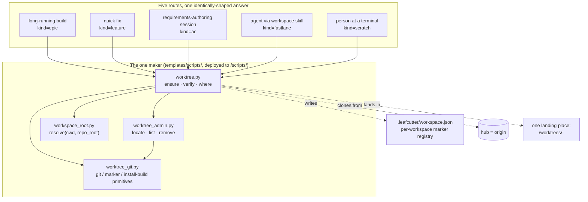

# Worktree Manager

## Overview

**Updated 2026-09-28 (BO-4300a-1).** The Worktree Manager no longer creates `git worktree`
entries that share the main checkout's `.git`. Per [ADR-018 Amendment
1](../adrs/ADR-018-agent-isolation-topology.md#amendment-1--2026-09-27--one-workspace-maker-hardlinked-clones-real-install-files),
every workspace — for a long-running build, a quick fix, a requirements-authoring session,
an agent following the workspace skill, or a person at a terminal — is now an independent,
hardlinked local-path clone of the main checkout, made, found, listed and cleared through
**one maker**: `templates/scripts/worktree.py`, deployed to `<install-root>/scripts/worktree.py`.
No other code path in the package may create, clone, locate or remove a workspace once
`BO-4300f-2` retires `setup_ticket_worktree.py`. The pre-2026-09-28 model (below, kept for
history) described seven divergent recipes across two scripts, four workflows and one
how-to; see the [worktree-consolidation
analysis](../../analysis/2026-09-25-worktree-creation-consolidation.md) for that inventory
and [its delivered-maker page §9](../../analysis/2026-09-25-worktree-delivered-maker.md#9-delivered--the-one-maker-2026-09-28)
for how the maker replaces it.

Each workspace carries a durable marker record (`.leafcutter/workspace.json`, outside
version control) instead of being tracked through `git worktree list` — no git command
lists clones, so `locate`/`list`/`verify` all read the marker registry directly.

### Component map

## Responsibilities

- Create, locate, list, verify and remove per-feature clone workspaces for every route —
  build, fix, AC-authoring, agent skill, and terminal — through the one maker
  (`templates/scripts/worktree.py`)
- Resolve the calling project's root through a separate, uncached resolver module
  (`templates/scripts/workspace_root.py`), never by re-implementing resolution inline and
  never by reusing `commit_guardian/_resolve_root.py`
- Build a real install (never a symlink) inside every workspace it makes, and prove each
  declared hook stage rejects a canary commit before answering `ready`
- Sweep orphan processes left behind after worktree teardown (legacy, `scripts/worktree/`)
- Provide the commit serialization lock (`epic-commit-lock`) used by ticket-supervisor

## Entry Points

- `templates/scripts/worktree.py` → deployed to `<install-root>/scripts/worktree.py` — the
  one maker. Verbs: `ensure` (the only creation verb, idempotent), `locate`, `list`,
  `verify`, `remove`, `where`.
- `templates/scripts/workspace_root.py` → deployed beside it — the separate project-root
  resolver `worktree.py` imports.
- `templates/scripts/worktree_git.py`, `templates/scripts/worktree_admin.py` — helper
  modules `worktree.py` imports (git/marker/install primitives, and locate/list/remove,
  respectively); each has its own named deploy-manifest entry.
- `scripts/worktree/sweep_processes.py` — orphan process cleanup (unchanged by this ticket)
- `scripts/setup_ticket_worktree.py` — the retired-in-place provisioning script. Still
  tracked pending `BO-4300f-2`; no new caller may be added against it.

## Safety Constraints

Per building-epics §1.4, worktrees MUST NOT be closed until all sub-tickets are done. The All-Tickets-Done gate (§1.4.1) enforces this by counting open tickets before allowing `worktree-agent` to run.

The maker's own safety constraints — the `ensure`-time canary commit that proves each
declared hook stage actually rejects (per-workspace, real `.git/hooks`, never a shared
worktree hooks directory), and the `remove` refusal of a dirty or unpushed workspace
unless `--force` is passed — are recorded in [ADR-018 Amendment
1](../adrs/ADR-018-agent-isolation-topology.md#amendment-1--2026-09-27--one-workspace-maker-hardlinked-clones-real-install-files)
§A1.3–A1.4 and in [the delivered-maker reference table §9.3](../../analysis/2026-09-25-worktree-delivered-maker.md#93-reference--cli-json-and-marker-schema).
The remainder of this section describes `scripts/setup_ticket_worktree.py`'s own
constraints; it still applies while that script remains tracked (pending `BO-4300f-2`),
but it is not the constraint set for the maker above.

The caller that invokes `scripts/setup_ticket_worktree.py` (`templates/workflows-js/plan-feature.js`'s
authoring-worktree creation step) MUST resolve it to an absolute, repository-anchored path
rather than a session-cwd-relative `.leafcutter/` one — otherwise, under the
[ADR-001](../adrs/ADR-001-self-hosting-boundary.md) self-hosting layout, the deployed copy
outside the repository can run instead of the copy inside it. See
[`docs/known-issues/ac-driven-dev.md`](../../known-issues/ac-driven-dev.md) → `KI-ACD-004`
for the reproduction and the fix (`buildRepoAnchoredResolutionCommand` /
`resolveRepoAnchoredScriptPath` in `plan-feature.js`), and
[`docs/architecture/components/ac-driven-dev.md`](ac-driven-dev.md) for the calling
component.

`scripts/setup_ticket_worktree.py` additionally hardens itself, independent of that
caller-side fix, against being invoked from outside any git repository at all (AC
`ACD-2100a-2`). Its `create-only` subcommand resolves the repository it operates on with
an ordered contract implemented by `_resolve_repository_with_search_fallback()`:

1. An explicit `--repo-root` supplied on the command line always wins outright and never
   consults the anchor or the search.
2. Otherwise the script's own on-disk anchor (`_git_toplevel()`) remains the first choice,
   unchanged for every caller that already works.
3. Only when the anchor fails does a bounded search run
   (`_search_immediate_subdirectory_repos()`) — over the *immediate* subdirectories of the
   process's current working directory only, never walking upward past it and never
   following a symlink out of it. The search returns its full candidate set, so an
   ambiguous layout (zero or more than one candidate) is representable and raised as an
   error rather than silently guessed.

A search-based resolution always announces itself on the diagnostic stream at WARNING
level, naming the repository it selected and stating that the selection came from a
search rather than from the script's own location — a silent fallback would be
indistinguishable from the anchor having worked and would leave a future
wrong-repository incident undiagnosable. See
[`docs/known-issues/ac-driven-dev.md`](../../known-issues/ac-driven-dev.md) → `KI-ACD-004`
("Fix landed 2026-08-31 (`ACD-2100a-2`)") for the failure this complements. The
`create-ac-worktree` and `create-fastlane-worktree` subcommands still call the bare
`_git_toplevel()` anchor with no fallback and are a known related gap outside this AC's
scope.
