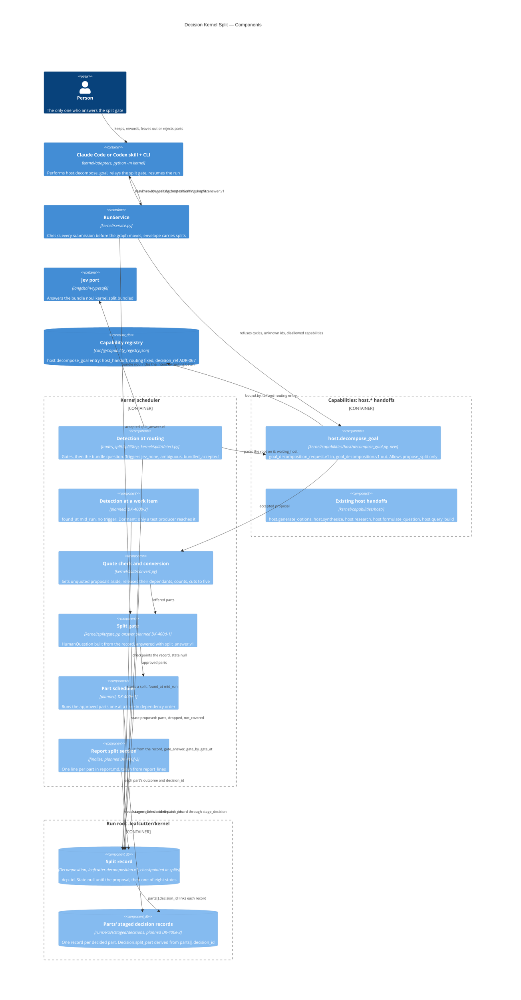

# Decision Kernel Split — Components

This page shows where each piece of a split sits among the kernel's existing containers, from
detecting a bundled request to the split record and the parts' decision records in the run root.

**Status: in progress, not on main.** The pieces without "planned" in their technology line are
built on the DK-400 E1 epic branch (DK-400a-1 to DK-400c-3). The pieces marked planned are
decided by [ADR-067](../adrs/ADR-067-kernel-splits-bundled-requests-into-approved-parts.md) and
built in later DK-400 epics. `split.enabled` stays false on main until DK-400e-1 turns it on
(ADR-067 §11), so a split does not reach a run on main yet.

The split adds no new container. Each piece is drawn inside one of the containers that
[Decision Kernel — Container Overview](../components/decision-kernel.md) already names.

Parent: [Decision Kernel and Colony Memory — Design Map](c2-007-decision-kernel-flows-overview.md)

See also: [Request Flow 2 — Host or Human Handoff](c3-014-decision-kernel-flows-request-handoff.md)
for how any host handoff, `host.decompose_goal` included, is served and resumed. The order of the
split's steps over time is the subject of the DK-400c-5 sequence diagram (planned).

## Where each piece sits

| Piece | Inside container | Code | Status |
|---|---|---|---|
| `host.decompose_goal` | Capabilities, beside the five existing `host.*` handoffs | `kernel/capabilities/host/decompose_goal.py`; its entry in `config/capability_registry.json` accepts `leafcutter.goal_decomposition_request.v1` and produces `leafcutter.goal_decomposition.v1` | Built (DK-400a-1, DK-400c-1) |
| Detection at routing | Kernel scheduler, route node | `SplitStep` in `kernel/scheduler/nodes_split.py`; gates and threshold in `kernel/split/detect.py` | Built (DK-400a-1, DK-400a-1-i, DK-400a-2) |
| Detection at a work item | Kernel scheduler | None yet; `FoundAt.MID_RUN` exists in `kernel/contracts/split.py` | Planned (DK-400b-2); dormant, only an injected test producer reaches it (ADR-067 §11) |
| Refusing an unsound proposal | RunService submission check, through the host operation | `DecomposeGoal.submission_violations` calls `dependency_problems` and `capability_problems`; a refusal exits 3 and changes nothing | Built (DK-400c-1-ii) |
| Quote check and conversion | Kernel scheduler, route node (`open_gate`) | `convert_proposal` in `kernel/split/convert.py`; `normalize_text` in `kernel/split/text.py` | Built (DK-400c-1-i, DK-400c-2, DK-400c-3) |
| Split gate | Kernel scheduler | `gate_proposal` in `kernel/split/gate.py` | Question built (DK-400c-1). The `leafcutter.split_answer.v1` answer, keep, reword and leave out are planned (DK-400d-1) |
| Gate relay | Claude Code or Codex skill + CLI | `kernel/adapters/claude_code/SKILL.md`, `kernel/adapters/codex/SKILL.md` | Planned (DK-400d-1-ii) |
| Part scheduler | Kernel scheduler | None yet | Planned (DK-400e-1) |
| Report split section | Kernel scheduler, `finalize` | `report_lines` on the split record | Planned (DK-400f-2) |
| Split record | Run root, checkpointed state key `splits` | `Decomposition` in `kernel/contracts/split.py`; `splits` in `kernel/scheduler/state.py` | Built (DK-400a-1). DK-400d-1 and DK-400e-1 fill the gate fields and part outcomes |
| Parts' staged decision records | Run root, `runs/<run_id>/staged/decisions/` | The existing staging gate, `kernel/memory/staging.py` | Planned (DK-400e-2) |
| Envelope `splits` | RunService | `kernel/service_envelope.py` | Built (DK-400a-1). The progress block is planned (DK-400f-1) |

## The split record and the parts' decision records

The split record is `leafcutter.decomposition.v1`, one per split work item, with an id of `dcp-`
plus 16 hex digits derived from the work item. Detection checkpoints it in the run root before the
run returns `waiting_host`, so a resumed run never creates a second split.

- **States.** `state` is null while the host's proposal is awaited. After that it is one of the
  eight states: `proposed`, `approved`, `in_progress`, `completed`, `ended_partial`, `rejected`,
  `rejected_clarify` and `rejected_kept_whole` ([spec §4.3](../../reference/kernel-request-splitting.md#43-leafcutterdecompositionv1-the-split-record)).
  The run is `waiting_host` while the proposal is awaited and `waiting_human` while the gate is
  open.
- **Set-aside and cut parts.** A proposal whose quote is not a verbatim span of the subject moves
  to `dropped[]` and counts for nothing. Parts beyond the five-part cap or the run's part
  allowance move to `not_covered[]` (ADR-067 §5).
- **Links to the parts' decision records (planned, DK-400e-2).** Each decided part stages its own
  record through the existing staging gate, with the record schema unchanged. The part's
  `parts[].decision_id` names that record, `Decision.split_part` is derived from it, and the run
  envelope's `decision_ids` lists every decided part's record (ADR-067 §9). A person publishes
  each record with `python -m kernel decisions publish`, as for any staged record.

## Containers in this view

Every container drawn here is a row of the
[container overview](../components/decision-kernel.md#containers):

| Drawn as | Container overview row |
|---|---|
| Claude Code or Codex skill + CLI | Claude Code or Codex skill + CLI |
| RunService | RunService |
| Jev port | Jev port |
| Capability registry | Capability registry |
| Kernel scheduler (boundary) | Kernel scheduler |
| Capabilities: host.* handoffs (boundary) | Capabilities |
| Run root .leafcutter/kernel (boundary) | Run root |

The decision store does its staging inside the run root and is named only on the
`stage_decision` arrow. Observability is left out because the split adds no trace of its own
beyond its `split.*` run events.

## Legend

| Element | Meaning |
|---|---|
| `Person` | A human actor. Here, the person who answers the split gate |
| `Container` | A container of the kernel's container overview, drawn whole. Here: the skill and CLI, RunService and the Jev port |
| `ContainerDb` | A container that holds data. Here, the capability registry |
| `Container_Boundary` | A container of the kernel's container overview, opened to show the split's components inside it. Here: the kernel scheduler, the capabilities and the run root |
| `Component` | A split piece inside its container: the module or class in the technology line, then what it does |
| `ComponentDb` | Data held inside a container. Here, the split record and the parts' staged decision records in the run root |
| `Rel` arrow and label | A call, a hand-off or a data link, read from the source to the target |
| "planned" in a technology line | A piece that ADR-067 decides but that is not built yet, with the AC that builds it |

## Cross-Links

- Parent: [Decision Kernel and Colony Memory — Design Map](c2-007-decision-kernel-flows-overview.md)
- Containers: [Decision Kernel — Container Overview](../components/decision-kernel.md)
- Sibling: [Request Flow 2 — Host or Human Handoff](c3-014-decision-kernel-flows-request-handoff.md), the existing host handoffs
- Decision: [ADR-067](../adrs/ADR-067-kernel-splits-bundled-requests-into-approved-parts.md); full rules in the companion specification, [part 1](../../reference/kernel-request-splitting.md) and [part 2](../../reference/kernel-request-splitting-2-conversion-gate-runs-config.md)

<!--
====================================================================
DECISION HISTORY
====================================================================
- 2026-10-10 [architecture-diagram-author, EPIC-ABundledRequestThatRoutingTurnsAwayIs/17]:
  Initial creation (DK-400c-4). Scaffold-free pass authorised by the user in
  decision dec-b10271ebb40b9eaa (approved 2026-10-10). The scaffold
  scripts/scaffold/new_arch_doc.py that write-c4-diagram step 4 requires is
  missing from this repository, so the frontmatter and the Legend were
  authored by hand under that authorisation. The frontmatter takes the shape of
  the existing L3 component diagrams (knowledge-management.md,
  self-heal-component.md) and the kernel siblings c3-013 to c3-022. The Legend
  has one entry per notation element used here; its general meanings follow
  the key of knowledge-management.md. No skill text was edited. INF-1300
  (TICKET-20261010-ScheduleArchDocScaffold) schedules the scaffold.
====================================================================
-->
