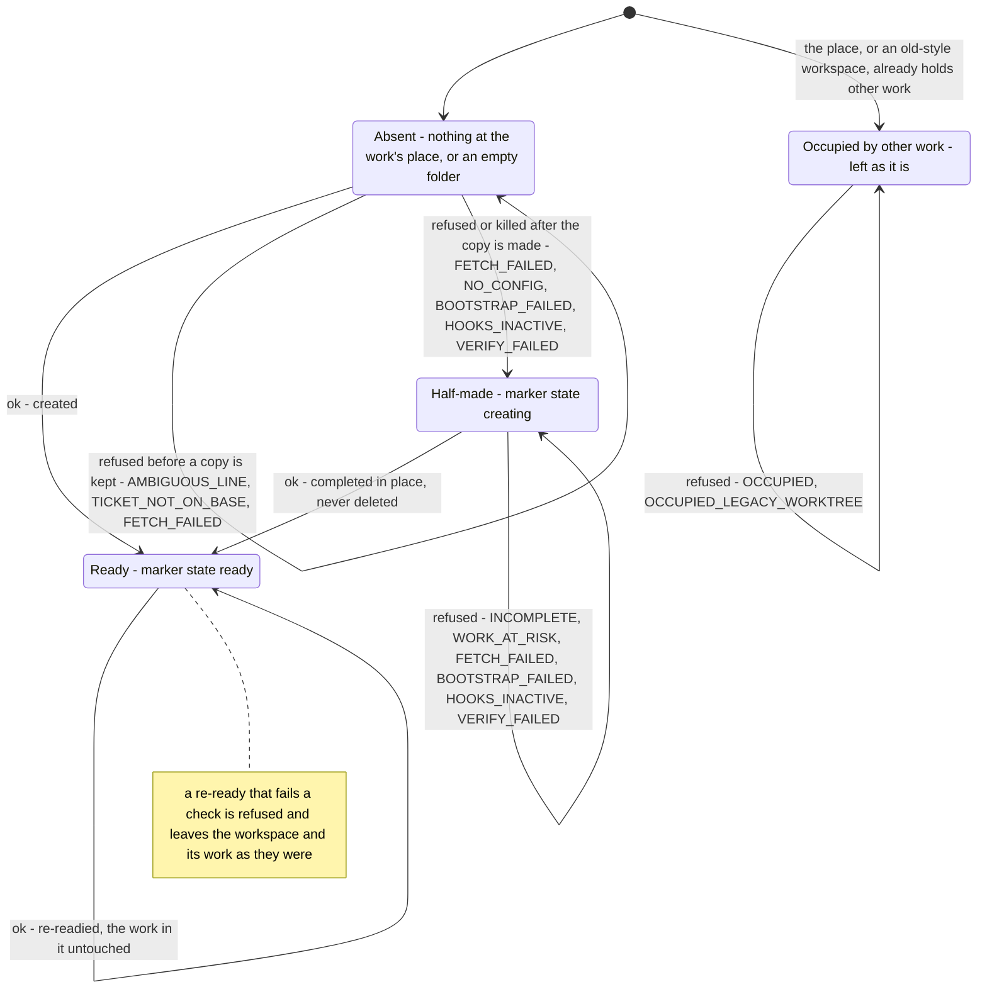

# Workspace States — What Asking for the Same Work Does in Each Situation

This page answers one question: **what happens when you ask for the workspace of a piece
of work, given what is already at its place?** The request is always
`worktree.py ensure --kind K --slug S`. Asking again for the same work is always safe
(BO-4300d-1 to BO-4300d-3).

**Status: built.** The decision is `_ensure_locked` in `templates/scripts/worktree.py`. It
asks `worktree_identity.occupied_refusal` first, then reads the workspace's marker
(`.leafcutter/workspace.json`). With no marker it creates the workspace. A marker in state
`creating` means half-made, and the workspace is finished in place. A marker in state
`ready` means the workspace is re-readied.

See also: [Worktree Manager — One Workspace Maker, Per-Feature Clones](../components/worktree-manager.md)
(the component page) and [Workspace request and the halt path](c3-030-workspace-request-halt-sequence.md)
(what the caller does with each answer).

## The states

| State | How the maker recognises it | Where |
|---|---|---|
| Absent | No folder at `<landing place>/<kind>/<slug>`, or an empty one. An empty folder is treated as absent, not as occupied | `_ensure_locked`, `empty_folder` |
| Half-made | A marker in state `creating`: written right after the clone, before the line of work is checked out and the tools are installed | `_create_workspace`, `_resume_workspace` |
| Ready | A marker in state `ready`: written last, atomically, only after every readiness ingredient was proven | `write_ready_marker` |
| Occupied by other work | The place holds another project's workspace, a folder with no marker, or a checkout of another line. Or the main copy still registers an old-style linked worktree for this work's line | `occupied_refusal` (occupant kinds `other-project`, `plain-folder`, `other-line`, `legacy-worktree`) |

## The transitions

| From | Answer | What happens to the place |
|---|---|---|
| Absent | `ok`, `workspace_action: created` | Cloned from the hub, line checked out, tools installed, hooks proven, then marked ready |
| Absent | refused before a copy is kept: `AMBIGUOUS_LINE` (more than one spelling of the work holds a line on the hub), `TICKET_NOT_ON_BASE`, or `FETCH_FAILED` when the clone itself fails | Stays absent. A clone made by this request is discarded (`discard_new_clone`) because it holds no work |
| Absent | refused after the copy is made: `FETCH_FAILED`, `NO_CONFIG`, `BOOTSTRAP_FAILED`, `BOOTSTRAP_DIRTIED_TRACKED`, `HOOKS_INACTIVE`, `VERIFY_FAILED`, or the request was killed | Becomes half-made: the `creating` marker stays, and the next request finishes the workspace |
| Half-made | `ok`, `workspace_action: completed` | Finished in place. The folder is never deleted to be finished |
| Half-made | refused: `INCOMPLETE` (the folder is on another line, has no `.git`, or its marker state is unknown), `WORK_AT_RISK` (an earlier request was killed while it held the work's changes aside), or a creation or readiness code as above | Stays half-made, untouched |
| Ready | `ok`, `workspace_action: re-readied` | Fetched, rebuilt and proven again. The work's uncommitted changes are set aside and put back byte for byte. The line keeps its recorded start and is never moved or rebased |
| Ready | refused: `FETCH_FAILED` (without `--allow-stale-base`), `WORK_AT_RISK`, `INCOMPLETE`, or a readiness code (the note in the diagram) | Stays ready: the marker is not rewritten, and the next request proves every ingredient again |
| Occupied | refused: `OCCUPIED` or `OCCUPIED_LEGACY_WORKTREE`, with an `occupant` object describing what is there | **Left as it is.** Nothing is created, moved, overwritten or deleted |

**No edge leaves Occupied.** The maker never changes an occupant to answer a request for
other work. The refusal names the occupant. Clearing it is a separate action that a person
takes, outside this request: deliver or move the other work, or bring an old-style
workspace over with `worktree.py migrate-legacy`. Only then does asking again find the
place absent.

**In every state:** a request the maker cannot place is refused before any state is
looked at (`AMBIGUOUS_REPO`, `NO_HUB`) and changes nothing. A request that arrives while
another request for the same work holds that work's lock waits a bounded time. It is then
refused with `IN_PROGRESS` and changes nothing. An error answer (`GIT_FAILED`, `NO_REPO`, `USAGE`, `INTERNAL_ERROR`) leaves the
place as a refusal would. No answer other than `ok` carries a workspace location.

**Not drawn here.** `remove` (clearing a workspace) is not a request for the same work. It
takes a ready workspace back to absent, or refuses `UNSENT_WORK` with a one-time
`discard_token`.

## Legend

| Element | Meaning |
|---|---|
| Rounded box | A state of the work's place. The text after the dash says how the maker recognises it |
| Arrow with a label | One `ensure` request for the same work, labelled with its answer (`ok` or `refused`) and, for a refusal, its codes |
| Arrow from a state back to itself | The request leaves the place in the state it was in |
| `[*]` | What is at the place before the first request |
| Note | A refused outcome that leaves the state unchanged, written as a note so the diagram stays readable |

## Cross-Links

- Component page: [Worktree Manager — One Workspace Maker, Per-Feature Clones](../components/worktree-manager.md)
- Sibling: [Workspace request and the halt path](c3-030-workspace-request-halt-sequence.md)
- Topology decision: [ADR-018 Amendment 1](../adrs/ADR-018-agent-isolation-topology.md)
- As-built answer table: [delivered-maker analysis §9.3](../../analysis/2026-09-25-worktree-delivered-maker.md)

<!--
====================================================================
DECISION HISTORY
====================================================================
- 2026-10-13 [architecture-diagram-author, EPIC-EveryPieceOfSeparateWorkGetsItsWorkspace/13]:
  Initial creation (BO-4300d-5). Numbered c3-031, not the c3-010 the AC
  named or the c3-011 the ticket proposed: both were taken by then, and the
  next number after c3-030 (scripts/next_diagram_seq.py 3 returned 30) was
  c3-031, free on origin/main and on every remote branch on 2026-10-13. Drawn
  under the user's scaffold-free pass, decision dec-b10271ebb40b9eaa
  (approved 2026-10-10 by human:user, the standing pass for every blocked
  diagram until a scaffold exists). The scaffold
  scripts/scaffold/new_arch_doc.py that write-c4-diagram step 4 requires has
  never existed in this repository, so the frontmatter and the Legend were
  authored by hand under that authorisation. The frontmatter takes the shape
  of the sibling L3 state diagram c3-025. The Legend has one entry per
  notation element used here. No skill text was edited. root: true, as on
  c3-008 and c3-009: no L2 doc exists above the worktree manager, and
  check-mermaid-parent-link refuses an L3 parent for an L3 diagram. The
  Absent -> HalfMade edge is drawn because it is built: the creating marker
  is written right after the clone, so a refusal or a kill after that point
  leaves a half-made workspace. The legacy-worktree occupant is kept inside
  Occupied, as an occupant kind, rather than drawn as a sub-state.
====================================================================
-->
