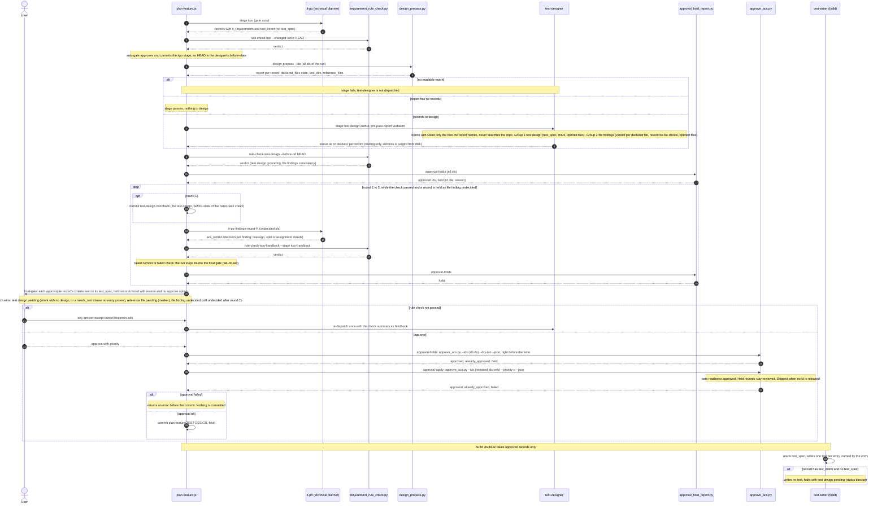

# Code-Aware Test Design — Sequence Diagram

The technical planner (`it-po`) cannot read source (ADR-009), so it records only which
outcomes need a test (`test_intent`). The test design is written later, before approval, by
`test-designer`. That agent may open source and existing tests (ADR-072). This page shows that
path in `/plan-feature` and then into the build, where `test-writer` uses the design. It also
shows where a record with intent but no design stops (ADR-071).

The order follows `templates/workflows-js/plan-feature.js`. The `itpo` stage gate is `auto`,
and one stage is appended: `{agent: "test-designer", stage: "test-design", gate: "final"}`. This
diagram also covers the superseded ACD-2500d-4. The file-aware checks of ACD-2500d (file
findings and the reference-file choice) run in the same `test-designer` dispatch as the test
design. They are not a separate step.

Parent: [AC Authoring Pipeline — Sequence Diagram](c2-002-ac-authoring-pipeline.md)

See also: [Requirement Part Owners — Component Diagram](c3-033-requirement-part-owners-components.md)
(who writes each field shown here, and who may read source),
[Requirement Rule Check — Component Diagram](c3-030-requirement-rule-check-components.md) (the
check in steps 3, 9 and 16) and [AC-Driven Development](../components/ac-driven-dev.md).

## Steps that need a note

| Step | What happens | Source of truth |
|---|---|---|
| 1 to 4 | The planner writes `test_intent` per outcome clause and never writes `test_spec` or `hold_reason`. Because the `itpo` gate is `auto`, the stage is committed without a pause, so the next rule check can compare against it with `--before-ref HEAD` | `it-po.md` §2.7; `plan-feature.js` pipeline |
| 5 to 6 | `design_prepass.py` reads each record once and only tests whether paths exist. It reads no file contents and writes nothing. Out-of-scope ids (not a leaf, or no intent, declared files or package surface) are skipped silently | `design_prepass.py` |
| alt after 6 | No report means no designer dispatch. A report with no records passes the stage with "nothing to design" | `dispatchTestDesign` |
| 7 to 8 | One dispatch writes both groups to separate fields. The agent's JSON only routes the stage. A `blocked` status fails it | `test-designer.md`; ADR-072 §2 |
| 9 to 10 | The stage check judges the written design and the findings against the tree | `requirement-rule-check.md` |
| 11 to 19 | An undecided finding is an approval hold, not a rule-check failure. Only `it-po` records the decision. A `split` creates records with intent and no design, and they are held as `test design pending`. Before round 1 the test design is committed as `test-design-handback`, so each round's check (`--stage itpo-handback`) compares against it. A failed commit or a failing check stops the run before the gate | `handBackFindings`; `_file_findings.undecided_findings` |
| 20 to 23 | The gate shows the holds from `approval_hold_report.py`. An unreadable report holds every id | `approvalHolds`; `_approval_holds.APPROVAL_HOLD_CHECKS` |
| 24 to 28 | Approval is one deterministic step, `approve_acs.py`. Its `--dry-run` reads the holds again right before the write, because records on disk may change during a pause. The apply gets only the ids it released. A failed run returns before the commit | `approveBatch` |

## When the gate is reached

The gate is always shown. A record is offered for approval only when all of its findings have a
recorded planner decision, it carries a design, and it has no `reference file pending` marker.
A record still undecided after round 2 appears at the gate as held, with its reason. It is never
offered for approval. The hand-back runs only on the live path, after a passing
`rule-check-test-design`. A failed hand-back dispatch ends the loop and leaves the records held.
A failing `itpo-handback` check stops the run before the gate.

## Test design pending in the build

The approval step (`approve_acs.py`) never writes `readiness: approved` on a held record, so `/build-ac` does not
pick it up. If a record with intent and no design reaches the test writer anyway, the test
writer writes no test. It halts with `test design pending`, names the AC id, and reports
`(status: blocker)`.

## Decision history

- 2026-10-22: ACD-300c-4 replaced the `status-checker` edit (`apply-approval`) with
  `approve_acs.py` (`approval-holds` dry run, then `approval-apply`), and the commit runs
  only after a successful approval. ACD-2500a-2-ix added the `test-design-handback` commit
  before hand-back round 1 and the fail-closed `itpo-handback` check after each round.
