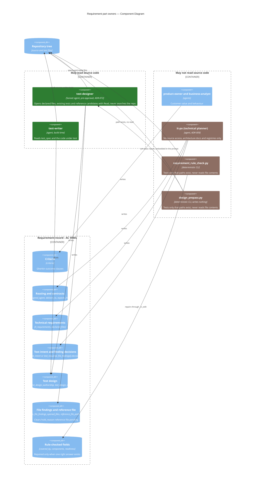

# Requirement Part Owners — Component Diagram

A requirement record is written in parts, and each part has one writer. The split follows what
each writer can know. The technical planner cannot read source (ADR-009), so it decides what
needs proof but not how to prove it (ADR-071). The test designer can read source (ADR-072), so
it writes the test design and the file findings. The rule check is deterministic, so it repairs
only fields that have exactly one right answer.

Parent: [AC Authoring Pipeline — Sequence Diagram](c2-002-ac-authoring-pipeline.md)

See also: [Code-Aware Test Design — Sequence Diagram](c3-032-code-aware-test-design-sequence.md)
(the order in which these writers run) and [AC-Driven Development](../components/ac-driven-dev.md).

## One writer per part

| Part | Fields | Writer | Every other owner |
|---|---|---|---|
| Criteria | `criteria` | product-owner, business-analyst | Reads only |
| Routing and contracts | `assigned_agent`, `delivers_to`, `expects_from` | it-po | test-designer must leave them unchanged (ADR-072 §2) |
| Technical requirements | `it_requirements`, `declared_files` | it-po | test-designer writes only the `reference_file_path` key, and only on a marked record |
| Test intent | `test_intent` or `test_required: false` | it-po | test-designer never edits it, not even an all-false intent |
| Test design | `test_spec`, `test_design_authorship`, `test_design_opened_files` | test-designer | it-po never writes `test_spec`. test-writer reads it only |
| File findings | `file_findings` (all keys except `decision`), `file_findings_opened_files` | test-designer | it-po writes only `decision` and never edits a verdict, reason, line range or `found_in` |
| Finding decisions | `file_findings[].decision` (`choice`, `reason`, `by: it-po`) | it-po | Written in the hand-back rounds of `/plan-feature` |
| Reference file | `it_requirements.reference_file_path` on a record marked `hold_reason: reference file pending` | test-designer | Chosen only from pre-pass candidates. The marker is cleared after the path is filled |
| Rule-checked fields | `covered_by`, `components`, `readiness` | requirement rule check | `_rc_edit` refuses any other field. Every authoring agent's `readiness: approved` is restored |
| Tests | test files in the repository | test-writer | Not a record field |

`design_prepass.py` writes nothing. It only gives the test designer its file facts.

## Who may read source code

Green owners may read source code. Brown owners may not.

- **test-designer** may open source, existing tests and reference candidates, but only with
  Read and only the files the pre-pass report and the record name. It may not use `find`,
  `grep -r`, `rg` or `git grep`. ADR-072 allows this single pre-approval agent.
- **test-writer** reads the code under test at build time and writes the tests.
- **it-po** may not read source (ADR-009). It works from architecture docs and registries.
  When a duty needs the code, it is left to the test designer.
- **requirement rule check** and **design pre-pass** are deterministic scripts. They test only
  that a path exists, and the pre-pass also lists the file names in a directory. Neither ever
  reads file contents. Both read requirement records and their own config.
- **product-owner** and **business-analyst** write customer-language criteria and do not read
  source.

## Note on the reference-file marker

The marker `hold_reason: reference file pending` is cleared by the test designer. Today no
built agent sets it. `it-po.md` says it never sets `hold_reason`, and the planner's side of
the marker is not in this group.
