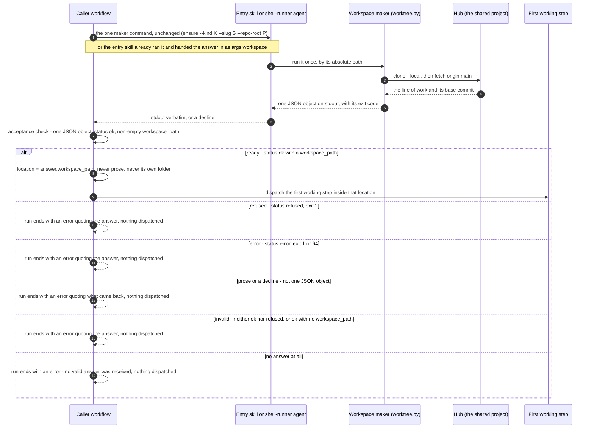

# Workspace Request — A Caller, the Workspace Maker, and the Halt Path

This diagram answers one question: **when does a workflow get to start working, and when
does it stop?** It follows one request from the moment a workflow needs a workspace to the
moment it either dispatches its first working step or ends the run (BO-4300c-3, BO-4300c-5).

**Status: built.** Every workflow that needs a workspace carries the same acceptance block,
`templates/workflows-js/_shared/workspace-answer.js`. The build copies it word for word
between the `WORKSPACE-ANSWER` markers of `build-epic`, `build-feature`, `build-ticket`,
`quick-fix`, `plan-feature`, `fast-lane-ship` and `finalize-feature`.

See also: [Worktree Manager — One Workspace Maker, Per-Feature Clones](../components/worktree-manager.md)
(the component page) and [Workspace states](c3-031-workspace-request-states.md) (what the
request does to the folder).

## The five ways an answer is not ready

The acceptance check is `workspaceAcceptAnswer`. It accepts exactly one shape: one JSON
object with `status` `ok` and a non-empty `workspace_path`. Every other answer becomes a
rejection with a `kind`. `workspaceFailure` turns that rejection into the run's own result:
`status: error`, with the message `Workspace step failed: <reason>. Received: <received>.
Nothing was dispatched after it and no other location was used.`, where `<received>` is
what came back, cut to at most 2 KB.

| Answer received | Rejection `kind` | What the run does |
|---|---|---|
| The maker refused (`status: refused`, exit 2), for example `OCCUPIED` or `UNSENT_WORK` | `refused` | Ends. The refusal names its cause; a person remedies it and asks again |
| The maker reported an error (`status: error`, exit 1, or 64 for `USAGE`) | `error` | Ends |
| A paragraph of prose, a bare file path, or a decline from the agent asked to run the command | `unreadable` or `declined` | Ends. A different command is never sent in place of the one declined (BO-4300c-3-ii) |
| JSON whose `status` is neither `ok` nor `refused`, or `ok` with no `workspace_path` | `invalid` | Ends |
| Nothing at all | `none` | Ends with "no valid answer was received" |

A shell reply that exited non-zero while its stdout says `ok` is rejected too, as `error`.

## Where the location comes from

There is one source of a location: the `workspace_path` of an accepted answer.
`workspaceObtain` reaches that answer in exactly one of three ways, in this order:

1. **Handed in.** The entry skill (`feature`, `build-single-ticket`, `plan-feature`) ran the
   maker itself and passed its answer verbatim as `args.workspace`. The workflow runs the
   same acceptance check on it.
2. **A handed-in location.** Whoever started the run passed `worktree_path` or
   `workspace_path`. The workflow sends one `verify --path` request for that location
   through the shell-runner. It goes on only if the answer is `ok` and names the same
   location (BO-4300c-4-i).
3. **One dispatch.** The workflow sends the maker command, unchanged, to the `shell-runner`
   agent (`permits_shell: true`). That agent runs it once and relays stdout verbatim
   (ADR-030: workflow bodies cannot run processes themselves).

Nothing falls back to the main copy, the epic folder, the folder the run started from, or
a location an agent describes in its own words.

## One thing the diagram deliberately shows

The `alt` block has no branch that reaches the first working step except the ready branch.
That is the invariant this page exists to show: **no path continues without a ready
answer.** The maker's internals (creating, re-readying or finishing a workspace) are
behind the `M->>H` exchange, and the state diagram draws them.

## Legend

| Element | Meaning |
|---|---|
| Participant box | One party to the request: the caller workflow, whoever runs the maker, the maker, the hub, and the first working step the workflow dispatches |
| Numbered solid arrow (`->>`) | A request or a dispatch, in time order |
| Dashed arrow (`-->>`) | A reply, or the run ending with its result |
| Arrow from a participant to itself | The caller deciding on its own, with no other party involved |
| `Note over` | Another way the same step can arrive (the handed-in answer) |
| `alt` / `else` block | Mutually exclusive outcomes of the acceptance check. Exactly one of them happens |

## Cross-Links

- Component page: [Worktree Manager — One Workspace Maker, Per-Feature Clones](../components/worktree-manager.md)
- Sibling: [Workspace states](c3-031-workspace-request-states.md)
- Topology decision: [ADR-018 Amendment 1](../adrs/ADR-018-agent-isolation-topology.md)
- Why workflows reach the maker only through an agent: [ADR-030](../adrs/ADR-030-dual-engine-workflow-support.md)
- As-built answer table: [delivered-maker analysis §9.3](../../analysis/2026-09-25-worktree-delivered-maker.md)

<!--
====================================================================
DECISION HISTORY
====================================================================
- 2026-10-17 [claude_code, merge of origin/main into BO-4300]: Renumbered c3-030 -> c3-034;
  main's c3-030-requirement-rule-check-components landed first (check-identifier-uniqueness).
- 2026-10-13 [architecture-diagram-author, EPIC-EveryPieceOfSeparateWorkGetsItsWorkspace/13]:
  Initial creation (BO-4300c-5). Numbered c3-030, not the c3-009 the AC
  named or the c3-010 the ticket proposed: both were taken by then, and
  scripts/next_diagram_seq.py 3 returned 30 (also free on origin/main and on
  every remote branch on 2026-10-13). Drawn under the user's scaffold-free
  pass, decision dec-b10271ebb40b9eaa (approved 2026-10-10 by human:user,
  the standing pass for every blocked diagram until a scaffold exists). The
  scaffold scripts/scaffold/new_arch_doc.py that write-c4-diagram step 4
  requires has never existed in this repository, so the frontmatter and the
  Legend were authored by hand under that authorisation. The frontmatter
  takes the shape of the sibling L3 sequence diagrams c3-012 and c3-009. The
  Legend has one entry per notation element used here. No skill text was
  edited. root: true, as on c3-008 and c3-009: no L2 doc exists above the
  worktree manager, and check-mermaid-parent-link refuses an L3 parent for an
  L3 diagram. The halt branches follow workspaceAcceptAnswer's rejection kinds
  as built.
====================================================================
-->
