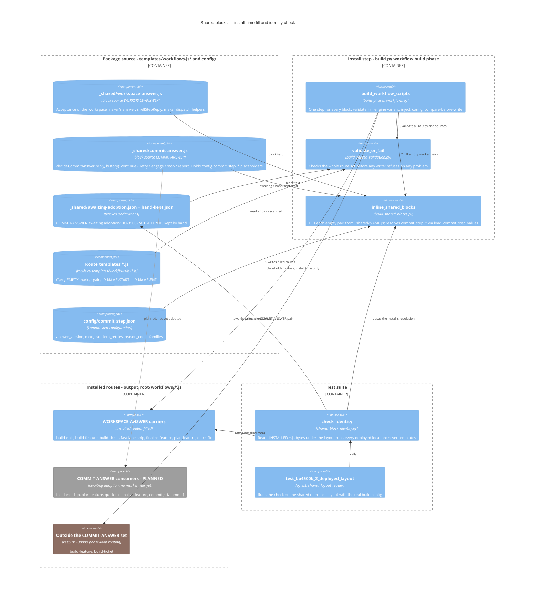

# Shared Blocks — Install-Time Fill and Identity Check — Component Diagram

Workflow bodies cannot `require` a module or call another workflow (ADR-030). So logic that
several routes share is written once, as a block source. The install copies that source into an
empty marker pair in each consuming route. A test then checks that every installed copy still
matches its source byte for byte. This diagram shows the components as built on 2026-10-23.

Parent: [Build Orchestration — Epic & Ticket Dispatch Sequencing](../components/build-orchestration.md)

See also: [Shared blocks reference](../../reference/shared-blocks.md) (the marker grammar),
[Install failures](../../reference/shared-block-install-failures.md) (each
install failure's text) and [ADR-030](../adrs/ADR-030-dual-engine-workflow-support.md) (why
workflow bodies cannot share code at run time). The commit step's own component diagram
(BO-4500a-5-ix) is not drawn yet. When it is, it links here for this mechanism rather than
redrawing it.

## Legend and notes

**Colours.** Grey is planned and not built: no installed route carries COMMIT-ANSWER yet. Brown
is outside the COMMIT-ANSWER set. The grey arrow from the COMMIT-ANSWER source is a plan, not
a fill.

**One step, two blocks.** WORKSPACE-ANSWER and COMMIT-ANSWER are two blocks on the same install
step. The build has no list of blocks or of consumers. A block is a file `_shared/<name>.js`,
and its name is that file name in capitals. A consumer is any top-level route template with a
marker pair. Adding a block means adding a source and a marker pair. The install code does not
change.

**Order inside the step.** `build_workflow_scripts` first runs `validate_or_fail` over every
route template and every block source. It collects every problem (unknown, empty, unused or
stale-declared block, a hand-filled pair, nested, overlapping or unpaired markers, a placeholder
it cannot resolve). If there is any problem, nothing is filled or written. Then each template's
empty pairs are filled. Then the engine variant is emitted and `inject_config` resolves the
route's own `{{config.*}}` placeholders. Last, compare-before-write skips any file that has not
changed. Templates keep their empty pairs; only installed routes hold the filled text.

**The commit step's configuration feeds the install, not the routes.** `commit-answer.js`
holds `{{config.commit_step_*}}` placeholders. `load_commit_step_values` fills them from
`config/commit_step.json` during the install. Installed routes read no file at run time
(ADR-030). A change to `commit_step.json` reaches a route only through the next install.

**The identity check reads installed routes.** `check_identity` walks every `*.js` under the
deployed layout root, so it covers every deployed location. It never reads templates. It
renders the expected text with the install's own resolution (`_block_text`, then
`inject_config`) and compares bytes. It names each route and block that differs and its first
differing line. It fails if it inspected zero copies. It reports COMMIT-ANSWER as "not
inspected because it awaits adoption", and it reports hand-kept pairs as not checked, without
failing.

**How this differs from BP-1000e.** BP-1000e compares one workflow *file* with its shipped
mirror copy: the whole file, one source to one copy, at the merge gate. This mechanism keeps one
*block* the same across *many* installed routes. It compares only the text between a marker
pair, against the block source as the install renders it. They check different things, and
neither one replaces the other. BP-1000e is not built yet (`work_status: todo`), and this tree has
no `scripts/workflows/` mirror directory.

## Built names win; differences noted

Where the BO-4500b-5 criteria wording and the built code differ, the diagram uses the built
names:

| Criteria wording | As built |
|---|---|
| block sources | `templates/workflows-js/_shared/<name>.js` (`workspace-answer.js`, `commit-answer.js`) |
| the install step that fills them | `build_workflow_scripts` in `scripts/build_phases_workflows.py`, calling `validate_or_fail` (`scripts/build_shared_validation.py`) and `inline_shared_blocks` / `fill_template_bytes` (`scripts/build_shared_blocks.py`) |
| the /commit route | `templates/workflows-js/commit.js` |
| COMMIT-ANSWER's consuming routes | **None consumes it yet.** No route template has a `// COMMIT-ANSWER-START` pair. `_shared/awaiting-adoption.json` declares the block as awaiting adoption by BO-4500a-5-i, -ii, -iii, -iv and BO-4500b-1-ii. The five routes are drawn as planned. |
| the commit step's configuration | `config/commit_step.json`, read through `{{config.commit_step_*}}` placeholders in the block source |
| the identity check | `check_identity` in `scripts/shared_block_identity.py`, run by `unit_tests/scripts/test_bo4500b_2_deployed_layout.py` |
| build-feature and build-ticket outside the set | True for COMMIT-ANSWER. Both still carry WORKSPACE-ANSWER. |

Also built but not named in the criteria:

- `build-epic.js` carries WORKSPACE-ANSWER.
- `create-ticket.js` carries no marker pair.
- `_shared/hand-kept.json` declares the `BO-3900-PATH-HELPERS` pairs in `build-feature.js` and
  `plan-feature.js` as hand copies. The install does not fill them, and the identity check does
  not compare them. Moving them to a `_shared` source is follow-up work.
