# Wrong-Version Runner — Component Diagram

A test that passes on the finished code but would also pass on a wrong version proves nothing.
Before a build commits, the wrong-version runner applies each wrong version the guarding tests
name, runs those tests, puts the code back and stops the work when a wrong version survives. There
is one runner. Four routes call it, and none of them holds a copy of its rule (TQ-500g-1).

This page shows the parts and what each one reads. Commands, reply fields, outcomes and file
shapes are listed in the [wrong-version runs reference](../../reference/wrong-version-runs.md).

```mermaid
C4Component
    title Wrong-version runner — Component Diagram

    Container_Boundary(routes, "Build routes - thin dispatch blocks only") {
        Component(fl, "fast-lane-ship.js", "workflow code", "fastlane-wv-recover, -list, -test-breaker, -finish")
        Component(bf, "build-feature.js", "workflow code", "bf-wv-recover, -list, -test-breaker, -finish")
        Component(bt, "build-ticket.js", "workflow code", "bt-wv-recover, -list, -test-breaker, -finish")
        Component(ts, "ticket-supervisor", "agent, for /build-epic", "Follows building-epics SKILL section 5.10.2; prompt text, not code")
    }
    Component_Ext(csr, "command-step-runner", "executor agent, Bash and Read", "Runs one command; relays stdout and exit code")

    Container_Boundary(prep, "Preparation - separate from the runner") {
        Component(tb, "test-breaker", "agent, tools: Read only", "Returns exact-match replacements; writes nothing, runs nothing")
        Component(wvw, "wrong_version_writer.py", "Python CLI: list, write", "list prints what is owed; write turns the reply into work/<work-key>/alterations.json")
    }

    Container_Boundary(cli, "Shared CLIs - scripts/build_orchestration") {
        Component(gate, "wrong_version_gate.py finish", "Python CLI", "1. consumer_sweep check, 2. writer write, 3. runner run")
        Component(sweep, "consumer_sweep.py", "Python CLI: record, check", "check stops on an edit to an existing test no list names; _cs_runs compares base and now")
        Component(wvr, "wrong_version_runner.py", "Python CLI: run, recover", "_wvr_scope, _wvr_records, _wvr_extras; applies, runs, puts back; fix undone from git")
    }
    Component(por, "pytest_outcome_reader.py", "shared reading, kind rule", "parse_pytest_outcomes; done_proof_kind_support and _kind_plugin")
    Component(dp, "done_proof verify_done_eligible", "proof-of-done check", "Reads runs through the shared reading")
    Component(rb, "fast_lane.py verify_red_baseline", "red-baseline reader", "heavy_lane_gate wraps it on the ticket routes")

    ComponentDb(acs, "AC store test_spec", "docs/acceptance-criteria/**/*.yaml", "must_catch, angle: discrimination, in_scope_files, requires_db")
    ComponentDb(cov, "covers tags", "test root", "# covers: tags link tests to requirement ids")
    ComponentDb(wvrun, "Run folder", "<git-dir>/leafcutter/wrong-version-runs/<run-id>/", "copy-<n>-<file>, journal.json")
    ComponentDb(trl, "To-run-later files", "<git-dir>/leafcutter/to-run-later/<ac-id>.json", "Extra wrong versions; a survivor never stops the work")
    Component(chk, "scripts/db_check/checker.py", "the only database reader", "check_test_db, resolve_test_db_address")
    SystemDb_Ext(tdb, "Configured test database", "testing_context.db_connection_test")

    Container_Boundary(be, "/build-epic backstop - in code") {
        Component(bej, "build-epic.js", "workflow code", "be-wv-recover at the drive head; be-gate-marker-open and -close per ticket")
        ComponentDb(gvd, "Gate-verdict records", "<git-dir>/leafcutter/gate-verdicts/<ticket-key>/", "open.json, red_baseline.json, wrong_version.json; gate_verdict_records.py")
        Component(hook, "check_build_epic_gate_verdicts.py", "pre-commit hook", "Refuses the commit unless both verdicts are on record, passing and fresh")
    }

    Rel(fl, csr, "dispatch block: recover, list, finish")
    Rel(bf, csr, "dispatch block: recover, list, finish")
    Rel(bt, csr, "dispatch block: recover, list, finish")
    Rel(fl, tb, "only when list owes names")
    Rel(bf, tb, "only when list owes names")
    Rel(bt, tb, "only when list owes names")
    Rel(ts, tb, "only when list owes names")
    Rel(csr, wvw, "list")
    Rel(csr, gate, "finish, test-breaker reply on stdin")
    Rel(csr, wvr, "recover")
    Rel(ts, wvw, "instruction-driven: own Bash call, list")
    Rel(ts, gate, "instruction-driven: finish --record")
    Rel(gate, sweep, "1. check")
    Rel(gate, wvw, "2. write")
    Rel(gate, wvr, "3. run --alterations manifest")
    Rel(wvr, wvw, "reads the manifest only")
    Rel(wvr, acs, "_wvr_records: scope")
    Rel(wvr, cov, "covers_tags")
    Rel(wvr, trl, "_wvr_extras, non-blocking")
    Rel(wvr, wvrun, "copies and journal; recover reads it")
    Rel(wvw, acs, "owed names, via the runner's scope reader")
    Rel(wvr, por, "_wvr_pytest")
    Rel(sweep, por, "_cs_runs through _wvr_pytest")
    Rel(dp, por, "reads")
    Rel(rb, por, "reads")
    Rel(wvr, chk, "_wvr_db: check_test_db; _wvr_db_plugin: resolve_test_db_address")
    Rel(chk, tdb, "the only database edge")
    Rel(bej, ts, "dispatches per ticket")
    Rel(bej, csr, "be-wv-recover, gate markers")
    Rel(wvr, gvd, "--record: wrong_version.json")
    Rel(rb, gvd, "heavy_lane_gate --record: red_baseline.json")
    Rel(hook, gvd, "reads, never writes")

    UpdateElementStyle(ts, $bgColor="#8d6e63", $borderColor="#5d4037")
    UpdateElementStyle(tb, $bgColor="#1565c0", $borderColor="#0d47a1")
    UpdateElementStyle(wvr, $bgColor="#2e7d32", $borderColor="#1b5e20")
    UpdateRelStyle(ts, wvw, $textColor="#8d6e63", $lineColor="#8d6e63")
    UpdateRelStyle(ts, gate, $textColor="#8d6e63", $lineColor="#8d6e63")
```

Context: the build phases this runner sits in are drawn in [Fast-Lane vs Heavy-Pipeline Phase Order — Component Diagram](c2-fast-vs-heavy-lane-phases.md).
This page is a root diagram; that page does not list it as a child.

See also: [Build Orchestration](../components/build-orchestration.md) (the component that owns
the runner, the writer, the gate wrapper and the sweep), [Build-Epic Workflow
Dispatch](../components/build-epic-workflow-dispatch.md) and [Phantom-Done
Prevention](../components/phantom-done-prevention.md).

## Legend

| Style | Meaning |
|---|---|
| Green node | The one runner. Every route reaches this same CLI; no route holds its rule |
| Blue node | The preparer, `test-breaker`. A read-only agent: its only output is one JSON reply |
| Brown node and edges | `/build-epic`'s call. `ticket-supervisor` runs the commands as its own Bash calls because the building-epics skill tells it to (section 5.10.2). The call is made through prompt text, not workflow code |
| Plain edge from a route | A **dispatch edge**, not a rule component. See the next section |

## One runner, four thin dispatch blocks

The rule lives once, in the Python CLIs. Each route holds a **thin dispatch block**: build the
command, hand it to the executor, parse the one JSON reply fail-closed, halt when
`gate_passed` is not the boolean true. The workflow engine has no module loader, so that block is
copied as text into `fast-lane-ship.js`, `build-feature.js` and `build-ticket.js`, and written out
as instructions in the building-epics skill. The copies hold the dispatch, never the verdict.

| Route | Labels | Reaches the CLIs through |
|---|---|---|
| fast lane | `fastlane-wv-recover`, `-list`, `-test-breaker`, `-finish` | `command-step-runner` |
| `/build-feature` | `bf-wv-recover`, `-list`, `-test-breaker`, `-finish` | `command-step-runner` |
| single-ticket route | `bt-wv-recover`, `-list`, `-test-breaker`, `-finish` | `command-step-runner` |
| `/build-epic` | building-epics SKILL section 5.10.2 steps 4 to 6 | `ticket-supervisor`'s own Bash calls (instruction-driven) |

Every route runs the same order: `recover`, then `list`, then `test-breaker` only when `owed`
is non-empty, then `finish`. On `/build-epic` the supervisor never runs `recover`; `build-epic.js`
runs it once at the drive head (`be-wv-recover`). Only the `/build-epic` path passes `--record`.

## Preparation is a separate step

The preparation step has two parts. `test-breaker` (tools: Read only) reads the finished code
and returns exact-match replacements for each owed name. It writes no file and runs nothing.
`wrong_version_writer.py write` applies each replacement where it matches exactly once, computes
the diffs itself and writes `<git-dir>/leafcutter/work/<work-key>/alterations.json`. The route
calls `finish`, and `finish` runs `write` before `run`. When the writer stops
(`stopped_at: "write"`), the runner does not run.

The runner only reads that manifest. "The fix undone" is not prepared by the preparation step. The
runner prepares it itself from git, as the code stood at the base ref.

## What the runner reads

| Input | Read by | Notes |
|---|---|---|
| AC store `test_spec` | `_wvr_records`, `_wvr_scope` | A covering test is in scope only when its own entry carries `must_catch` or `angle: discrimination`. `in_scope_files` limits where a name may alter code; `requires_db` marks tests that need the test database. Requirement prose is never read |
| `# covers:` tags | `_wvr_records.covers_tags` | Found in the test root |
| To-run-later files | `_wvr_extras` | `<git-dir>/leafcutter/to-run-later/<ac-id>.json`, a second input. Extras are run and reported, but a survivor among them never stops the work. The writer's `list` sees the same set |
| Alterations manifest | `_wvr_scope` | Only `name`, `status`, `reason` and `files` are read. Claim fields such as `caught` are never read |
| Run folder | `_wvr_gate` | `<git-dir>/leafcutter/wrong-version-runs/<run-id>/` holds the as-written copies (`copy-<n>-<file>`) and `journal.json`, written before a file is altered. `recover`, and the start of every `run`, reads it and puts back a cut-short run's code |

## One shared reading of test runs

`scripts/ac_store/pytest_outcome_reader.py` is the one reading of a `pytest -v` run into
`{nodeid: outcome}`. The kind rule beside it is `done_proof_kind_support` with the pytest plugin
`_kind_plugin`. Four readers use it and none keeps its own pattern or outcome table:

| Reader | How it reaches the shared reading |
|---|---|
| wrong-version runner | `_wvr_pytest` (`parse_pytest_outcomes`, plus the kind rule) |
| proof-of-done check | `done_proof.verify_done_eligible` |
| red-baseline reader | `fast_lane.py verify_red_baseline`, which `heavy_lane_gate` wraps on the ticket routes |
| consumer sweep | `_cs_runs`, which runs base and now through `_wvr_pytest.run_selected` |

## One test database

The only database the runs touch is the configured test database
(`testing_context.db_connection_test`). It is reached only through `scripts/db_check/checker.py`:
`_wvr_db` calls `check_test_db` once per run for the gate, and the pytest plugin `_wvr_db_plugin`,
including its `put-back` entry, gets the address only from `resolve_test_db_address`. No other
database edge exists. When the setting is missing or unreadable, or the database cannot be
reached, the database tests get `not_run` rows that say why. They are never read as caught or
passed, and the work stays unfinished.

## The /build-epic backstop

`ticket-supervisor`'s call is prompt-driven, so a supervisor that skipped it could still commit.
The backstop runs in code:

1. `build-epic.js` runs `be-wv-recover` and `be-gate-marker-close-all` at the drive head, then
   opens a marker (`gate_verdict_records.py open`, label `be-gate-marker-open`) before it
   dispatches each ticket and closes it afterwards (`be-gate-marker-close`).
2. `wrong_version_gate.py finish --record` (the runner writes `wrong_version.json`) and
   `fast_lane.py heavy_lane_gate --record` (`red_baseline.json`) write the records under
   `<git-dir>/leafcutter/gate-verdicts/<ticket-key>/`, next to the marker `open.json`.
3. The pre-commit hook `check_build_epic_gate_verdicts.py` reads them while a marker is open. It
   refuses the commit unless the marked ticket is staged and both verdicts are on record, readable
   and passing, and the wrong-version record covers the staged code (sha256 of each staged path).
   It never reads a ticket comment or the supervisor's own account.

Residual gap: a commit made with `git commit --no-verify` skips the hook. The building-epics
skill's `--no-verify` override policy (section 5.8) governs that, not this check.
