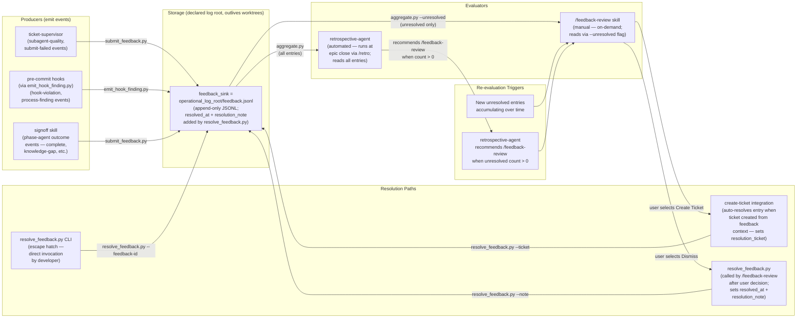

# Feedback Lifecycle — Data Flow

## Purpose

This document describes the complete lifecycle of a feedback entry in the leafcutter
system: how entries are produced, where they are stored, how they are evaluated, and
how they are resolved. It covers all producers, the central storage format, the
evaluation agents, and the three resolution paths available after review.

---

## Diagram



Parent: [Agent Delivery Workflows](./agent_delivery_workflows.md)

---

## Nodes Reference

### Producers

| Node | Description | Script |
|------|-------------|--------|
| `ticket-supervisor` | Emits `subagent-quality` events when an agent retry or halt occurs; emits `submit-failed` events when `submit_feedback.py` itself fails | `submit_feedback.py` |
| `pre-commit hooks` | Emits `hook-violation` and `process-finding` events whenever a pre-commit check fires a finding | `emit_hook_finding.py` |
| `signoff skill` | Every phase agent calls `submit_feedback.py` during sign-off; emits outcome events (`complete`, `knowledge-gap`, `convention-ambiguity`, `tooling-issue`, etc.) | `submit_feedback.py` |

### Storage

| Node | Description | Location |
|------|-------------|----------|
| `feedback.jsonl` | Append-only JSONL file; one JSON object per line; `resolved_at` and `resolution_note` fields added in place when an entry is resolved | The declared `feedback_sink`, one per install, shared by every worktree of it. See [Where every log is kept](#where-every-log-is-kept--one-declared-log-root-adr-069) |

### Evaluators

| Node | Description | Trigger |
|------|-------------|---------|
| `retrospective-agent` | Reads the full feedback corpus via `aggregate.py`; produces a structured retrospective with category breakdown, subagent quality trends, and proposed improvements | Automated — invoked at epic close via `/retro` |
| `/feedback-review skill` | Reads only unresolved entries via `aggregate.py --unresolved`; presents each entry to the user for triage (create ticket, dismiss, skip) | Manual — on-demand by user |

### Resolution Paths

| Path | Description | Method |
|------|-------------|--------|
| `create-ticket integration` | Auto-resolves the originating feedback entry when a ticket is created from feedback context; sets `resolution_ticket` to the new ticket path | `resolve_feedback.py --ticket <path>` |
| `/feedback-review manual` | Called by `/feedback-review` after the user selects Dismiss; sets `resolved_at` and `resolution_note` | `resolve_feedback.py --feedback-id <id> --note "<reason>"` |
| `resolve_feedback.py CLI` | Direct invocation escape hatch for developers who want to resolve an entry outside the skill flow | `python scripts/feedback/resolve_feedback.py --feedback-id <id>` |

---

## Where every log is kept — one declared log root (ADR-069)

Every log in the operational log directory (`feedback.jsonl`, `agent_telemetry.jsonl`,
`knowledge_emissions.jsonl`, `inline_work_guard.jsonl`) sits in **one enduring directory**,
`operational_log_root`. The per-drive worktree is deleted after the drive; this directory
outlives it. The build records the directory in `<output_root>/config/knowledge_sink.json`,
together with `feedback_sink`, `operational_telemetry_stream` and `knowledge_emission_sink`.
Writers and readers read this declaration. Nothing works the location out at run time.
Decision and alternatives: [ADR-069](./adrs/ADR-069-durable-log-root-for-workspaces.md). The
acceptance criterion for this section is [INF-500d-4-vii](../acceptance-criteria/infrastructure/INF-500-operational-observability/INF-500d-4-vii.yaml).

- **A usable stream.** A stream counts only when the declaration also records an absolute
  `operational_log_root` and the stream is an absolute path directly under it
  (`sink_resolution.read_usable_stream`; `emit_event.py` keeps an inline copy).
- **How the root is chosen.** `build.py --log-root <abs-dir>` records the given directory.
  A relative value is refused before anything is written. With no flag, an ordinary build
  records `<project>/debugging/logs`. `--no-log-root` records an empty declaration (`{}`),
  so every writer refuses. A worktree bootstrap (`setup_ticket_worktree.py`) passes the
  root the main install recorded in `<main>/.leafcutter/config/knowledge_sink.json`, or
  warns and passes `--no-log-root` when it cannot read one. If the worktree's older
  `build.py` rejects the flag (exit 2, `unrecognized arguments`), the bootstrap retries once
  without it and warns that the worktree has no durable log root. Git-based discovery was
  rejected ([INF-400c-4](../acceptance-criteria/infrastructure/INF-400-agent-learning/INF-400c-4.yaml), ADR-069).
- **Stale versus first write.** Stale means the enduring root is gone: the directory holding
  `operational_log_root` (its parent, or the project above `debugging`;
  `sink_resolution.enduring_root_exists`). A missing log directory under a live root is a
  fresh install and gets its first write. `submit_feedback.py`, `emit_event.py` and
  `inline_work_guard.py` create only up to the log directory, and only under a live root.
- **Asking without filing.** `python3 .leafcutter/scripts/knowledge/sink_resolution.py
  --print-location {root|feedback|telemetry|knowledge}` prints one absolute path and creates
  nothing. A missing declaration or key, or an unusable stream: no stdout, an ERROR, exit 1.
  Shipped prompts pass no log path of their own; they rely on the writers' declared defaults or ask this query (INF-500d-4-vi).
- **When the location cannot be determined.** `submit_feedback.py` without `--jsonl` prints
  one `destination could not be written` line naming the declaration and the condition
  (absent, unreadable, unparseable, missing key, not absolute, not under the root, or stale),
  exits 1 with no id, and never falls back to the working directory or the script's location.
  `emit_event.py` and `inline_work_guard.py` warn and write nothing; their `.gemini` copies
  step out of the `gemini` directory and read the same install's declaration.
- **Readers.** The feedback readers, `generate_health_report.py`, `weekly_health.py` and
  `extract_epic_facts.py` print `read N records from <absolute path>` on stderr, or exit 1
  without a usable declaration. An explicit path is used as given. A feedback reader names,
  once, a populated pre-declaration `feedback.jsonl` that differs from the sink, and leaves
  it alone. A rewrite (`link_feedback.py`, `resolve_feedback.py`) first copies the sink to
  `<sink>.bak-<UTC timestamp>`, removed on success and named on failure.
- **Earlier reports are not carried over.** No sink was moved or merged. The one-off rescue
  is [`reports/feedback-snapshots/`](../../reports/feedback-snapshots/README.md).
- **Three rules, kept separate.** (a) Configuration resolves to the workspace's own
  `.leafcutter/config` (INF-100c-1-i). (b) Commit guards resolve to the worktree being
  judged (GE-113c-1-iv). (c) Logs go to the declared root. Rule (b) returns the very
  directory that gets deleted, so the guard resolver is not reused for logs. A single
  resolver for all three rules would bring the defect back. The declaration file is found
  by rule (a), and only the value it holds is rule (c).

---

## Entry Schema (summary)

Each `feedback.jsonl` entry carries these key fields:

| Field | Description |
|-------|-------------|
| `feedback_id` | Unique ID (`fb_YYYY-MM-DD_XXXXXXXX`) |
| `timestamp` | ISO 8601 emission time |
| `phase` | Agent or hook that emitted the entry |
| `category` | Outcome category (`complete`, `knowledge-gap`, `subagent-quality`, `hook-violation`, etc.) |
| `severity` | `info`, `warning`, or `error` |
| `note` | Human-readable description of the event |
| `tags` | Optional list of kebab-case descriptors |
| `resolved_at` | ISO 8601 timestamp set when entry is resolved (absent if unresolved) |
| `resolution_note` | Human-readable reason for resolution (absent if unresolved) |
| `resolution_ticket` | Path to the ticket created from this entry (optional) |

---

## Re-evaluation Cycle

1. Entries accumulate in `feedback.jsonl` during an epic drive.
2. `retrospective-agent` reads the corpus at epic close and recommends `/feedback-review`
   when `aggregate.py --unresolved` returns count > 0.
3. User (or retrospective-agent) invokes `/feedback-review`.
4. For each unresolved entry, the user chooses: Create Ticket, Dismiss, or Skip.
5. Resolved entries have `resolved_at` set; skipped entries remain unresolved for the next cycle.
6. The cycle repeats on the next epic close or on-demand invocation.

---

## Config Resolution — Source Repo and Deployed Layouts (AC INF-100c-2)

When `submit_feedback.py` runs from the leafcutter source tree at
`leafcutter-ai/scripts/feedback/`, it must find `feedback_categories.yaml` at
`leafcutter-ai/config/feedback_categories.yaml`. This is the source-repo layout,
distinct from the deployed-project layout (`.leafcutter/`).

The `_find_config_root()` function achieves this by anchoring to `__file__` and
returning `Path(__file__).resolve().parents[2] / "config"`. For the source repo:

- Script at `leafcutter-ai/scripts/feedback/submit_feedback.py`
- `parents[2]` = `leafcutter-ai/`
- Config found at `leafcutter-ai/config/` ✓

This preserves backward compatibility: the source-repo config layout (`config/`
adjacent to `scripts/`) is identical to the deployed layout (`.leafcutter/config/`
adjacent to `.leafcutter/scripts/`), so the same `parents[2]` resolution works
in both cases.

**Verification:** `unit_tests/feedback/test_submit_feedback_config_resolution.py`
class `TestConfigRootFromSourceRepoLocation` (AC INF-100c-2).

---

## Config Resolution in Git Worktrees (AC INF-100c-1-i)

When leafcutter is deployed into a project at `<project>/.leafcutter/` and a git
worktree is created from that project, `submit_feedback.py` must resolve its config
without walking past `.leafcutter/` into the parent directory.

### How it works

`submit_feedback.py` uses `_find_config_root()` which anchors config resolution to
the script file's own location via `Path(__file__).resolve().parents[2] / "config"`.

This means:

| Deployment layout | Script location | Config resolved at |
|---|---|---|
| Source repo | `leafcutter-ai/scripts/feedback/submit_feedback.py` | `leafcutter-ai/config/` |
| Deployed project | `<project>/.leafcutter/scripts/feedback/submit_feedback.py` | `<project>/.leafcutter/config/` |
| Git worktree of deployed project | `<worktree>/.leafcutter/scripts/feedback/submit_feedback.py` | `<worktree>/.leafcutter/config/` |

### Invariant

The config directory is always exactly **two parents above the script file**, regardless of:

- The process working directory (CWD)
- The presence of `.claude/` markers in the directory tree
- The existence of a `config/` directory in the worktree's parent

This is enforced by the `_find_config_root()` function. The former `_find_project_root()`
`.claude/` walk, which chose the JSONL log path, was removed by INF-500d-4-i. The log path
now comes from the declaration described above.

**Cross-reference:** AC INF-100c-1 (base), AC INF-100c-1-i (worktree scenario),
`unit_tests/feedback/test_submit_feedback_worktree_resolution.py`.

---

## Missing Config — Actionable Error Messages (AC INF-100c-4)

When `submit_feedback.py` cannot find `feedback_categories.yaml` at the resolved
config path, the error output is designed to be immediately actionable:

```
ERROR: Cannot read feedback_categories.yaml.
  Checked path: /absolute/path/to/config/feedback_categories.yaml
  OS error: [Errno 2] No such file or directory: '/absolute/path/to/...'
  To fix: Place feedback_categories.yaml at /absolute/path/to/config/feedback_categories.yaml
```

### Why this format

The error message labels each piece of information separately:

| Line | Purpose |
|------|---------|
| `ERROR: Cannot read feedback_categories.yaml.` | Human-readable headline identifying the file |
| `Checked path: <absolute-path>` | Labelled absolute path — copy-pasteable for verification |
| `OS error: <exc>` | Raw OS error for low-level debugging (file permissions, filesystem issues) |
| `To fix: Place feedback_categories.yaml at <path>` | Explicit remediation command |

This structure satisfies AC INF-100c-4: "the error message includes the full absolute
path(s) that were checked, and the message is actionable for debugging."

### Contrast with prior format

Before AC INF-100c-4 was implemented, the error was:
```
ERROR: Cannot read categories file <path>: [Errno 2] No such file or directory: '<path>'
```
The path was present but embedded inside the OSError string, making it hard to distinguish
from the exception detail. The new format labels the path explicitly.

**Cross-reference:** `unit_tests/feedback/test_submit_feedback_missing_config.py` (AC INF-100c-4).

---

## Cross-Links

- Parent: [Agent Delivery Workflows](./agent_delivery_workflows.md) — supervisor dispatch topology
- Related: [Agent Knowledge System](./agent_knowledge_system.md) — how agents classify and persist learnings
- Decision: [ADR-069](./adrs/ADR-069-durable-log-root-for-workspaces.md) — one durable log root, declared as a build input
- Component: [Feedback Collector](./components/feedback-collector.md) — writers and readers of the declared sink
- Skill: `templates/skills/feedback-review/SKILL.md` — procedural definition of the `/feedback-review` triage flow
