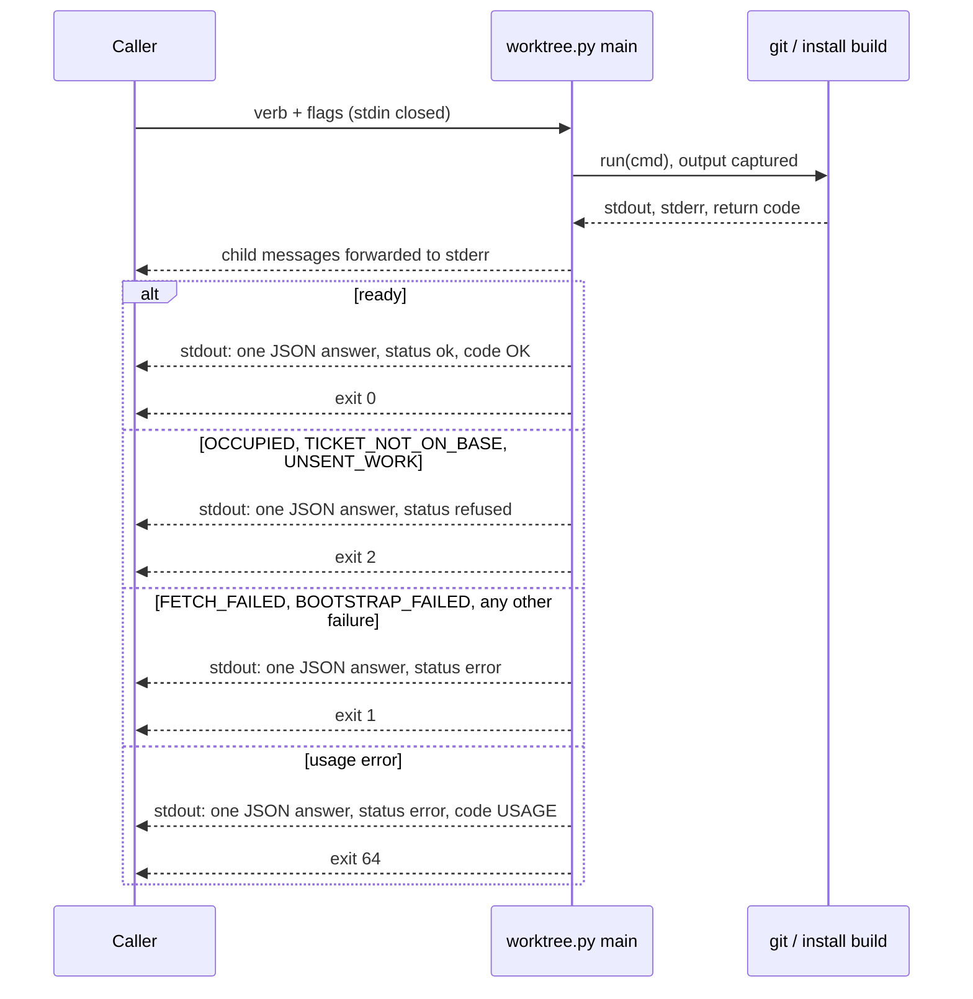

> **Parent document:** [workspace-maker-interface.md](workspace-maker-interface.md)

# Workspace Maker Answers and Codes

Lookup tables for what `worktree.py` prints and returns: the JSON answer fields, the refusal codes, and the process exit codes. Verbs, flags, the marker file and the readiness checks are in the parent document.

---

## JSON Answer Shape

Source: `worktree.py` (`main`, `_ok`, `_entry`, `_ready_answer`, `verb_*`) and `workspace_core.MakerError.payload`. Every invocation prints exactly one JSON object followed by a newline on stdout, and nothing else; see [One Answer, Separate Channels](#one-answer-separate-channels).

### Fields on every answer

| Field | Type | Meaning |
|---|---|---|
| `schema_version` | integer | `SCHEMA_VERSION` (currently `1`). Adding a field is compatible; renaming or removing one bumps it. |
| `status` | string | `"ok"`, `"refused"` or `"error"`: every answer states which. |
| `code` | string | `"OK"` or a code from Status and Refusal Codes. |
| `verb` | string | Verb that answered; `"unknown"` when the first word is not a verb. |
| `message` | string | One sentence naming the cause (`"<verb> succeeded"` on ok). |

### Additional fields on every ok answer

| Field | Type | Meaning |
|---|---|---|
| `mechanism` | string | `"clone"`. |
| `maker_version` | string | `MAKER_VERSION`. |

### Workspace entry fields (`_entry`)

Present on `ensure`, `locate`, `verify`, `remove`, and on each element of `list.workspaces`.

| Field | Type | Meaning |
|---|---|---|
| `kind` | string | Marker `kind`. |
| `slug` | string | Normalised work identity. |
| `branch` | string or null | Line of work; null for `scratch`. |
| `state` | string | Marker `state`: `creating` or `ready`. |
| `hub` | string | Hub URL (the main checkout's `origin`). |
| `project_root` | string | Absolute path of the main checkout the workspace was made from. |
| `base_commit` | string | Hub `main` tip the workspace started from. |
| `workspace_path` | string | Absolute workspace path, native separators. |
| `workspace_path_posix` | string | Same path with forward slashes. |
| `worktree_path` | string | Same value as `workspace_path` (legacy name). |

### Verb-specific ok fields

| Verb | Additional fields |
|---|---|
| `ensure`, `verify` | `origin_main_commit` (string or null: `refs/remotes/origin/main` in the workspace), `base_matches_origin_main` (boolean), `checks` (object; see Readiness Checks in the parent document). |
| `ensure` with `--ticket` | `ticket_path_in_worktree` (string), `ticket_path_in_worktree_posix` (string); see [Ticket Location Fields](#ticket-location-fields). |
| `locate` | Entry fields only. |
| `list` | `workspaces` (array of entry objects). |
| `remove` | Entry fields of the removed workspace, `removed` (boolean, `true`), `removed_path` (string: the folder that was deleted; the answer is `ok` only after a post-check finds nothing left there), `discarded` (object `{commits, files}`: the unsent work thrown away under `--discard`; both lists empty for a clean workspace). |
| `where` | `maker_path` (string). `where` carries no entry fields. |

### Ticket Location Fields

Source: `workspace_create.ticket_fields`, `check_ticket_on_base`, `ticket_rel`; `worktree.verb_ensure`. Added to an `ensure` answer only when the request carried `--ticket`.

| Field | Type | Meaning |
|---|---|---|
| `ticket_path_in_worktree` | string | Absolute path of the ticket inside `workspace_path`, native separators. |
| `ticket_path_in_worktree_posix` | string | Same path with forward slashes. |

| Rule | Detail |
|---|---|
| Presence | On an ok answer to a request with `--ticket` only. ABSENT (the key is not in the object, never `null`) on every non-ok answer and on any request without `--ticket`. |
| Location | Both values lie inside `workspace_path`. |
| Content, new workspace | The main copy's git blob hash is compared with `HEAD:<path>` (the base: `origin/main`, or the resumed hub line) after the fetch and checkout, before the install build. Absent or different is `TICKET_NOT_ON_BASE`, and the half-made workspace is cleared. |
| Content, resumed workspace | The ticket must exist at the resumed line's `HEAD`; there is no byte comparison with the main copy, so a ticket the line itself edited and committed is accepted. Absent at `HEAD` is `TICKET_NOT_ON_BASE` (`reason: absent`). The workspace is kept, never altered or cleared. |
| Regular file | In both cases the stated location must be a regular file, not a symlink; otherwise `TICKET_NOT_FOUND`. |
| Never emitted | `ticket_path_final` and `ticket_path_new`, not even as aliases. Both names were read as "the ticket inside the workspace" while meaning the input path (the `--ticket` value as requested). |

Example, `ensure --kind ticket --slug BO-4300a-1-ii --ticket tickets/00_inbox/t.md` on a new workspace:

```json
{"status": "ok", "code": "OK", "verb": "ensure", "workspace_path": "/ws/ticket-BO-4300a-1-ii", "ticket_path_in_worktree": "/ws/ticket-BO-4300a-1-ii/tickets/00_inbox/t.md", "ticket_path_in_worktree_posix": "/ws/ticket-BO-4300a-1-ii/tickets/00_inbox/t.md"}
```

(Entry, `checks` and version fields elided.)

### Refused answer

Returned for `TICKET_NOT_ON_BASE`, `OCCUPIED` and `UNSENT_WORK` (`workspace_core.REFUSAL_CODES`): the maker declined the request; nothing is broken.

| Field | Type | Meaning |
|---|---|---|
| `schema_version` | integer | Contract version. |
| `status` | string | `"refused"`. |
| `code` | string | `TICKET_NOT_ON_BASE`, `OCCUPIED` or `UNSENT_WORK`. |
| `verb` | string | Verb requested. |
| `message` | string | Human-readable cause. |
| `ticket_path` | string | `TICKET_NOT_ON_BASE` only: the `--ticket` value exactly as requested. |
| `reason` | string | `TICKET_NOT_ON_BASE` only: `"absent"` (base or resumed `HEAD` lacks the file) or `"differs"` (new workspace only: base holds other bytes than the main copy). |
| `workspace_path` | string | `OCCUPIED` only: the occupying folder. Never on `TICKET_NOT_ON_BASE` or `UNSENT_WORK`. |
| `unsent` | object | `UNSENT_WORK` only: `commits` (list of commit identifiers on the workspace's branch reachable from neither `origin/<branch>` nor `origin/main` after a fetch) and `files` (list of paths with uncommitted or untracked changes). |

Like an error answer, a refused answer carries no `mechanism` or `maker_version`.

```json
{"status": "refused", "code": "TICKET_NOT_ON_BASE", "verb": "ensure", "message": "tickets/00_inbox/t.md is absent on the workspace's base; push it and ask again", "ticket_path": "tickets/00_inbox/t.md", "reason": "absent"}
```

### Error answer

| Field | Type | Meaning |
|---|---|---|
| `schema_version` | integer | Contract version. |
| `status` | string | `"error"`. |
| `code` | string | Error code (see Status and Refusal Codes). |
| `verb` | string | Verb requested; `"unknown"` when the first word is not a verb. |
| `message` | string | Human-readable cause. |
| `workspace_path` | string | Optional. Present on `WORKSPACE_INCOMPLETE`, `NOT_READY` (verify), and `TICKET_NOT_FOUND` after creation. |
| `checks` | object | Optional. Present on `NOT_READY` raised by `require_ready`. |
| `candidates` | list | Optional. Present on `AMBIGUOUS_REPO`. |
| `how`, `searched_from` | string | Optional. Carried over from the resolver result on `AMBIGUOUS_REPO` and `NO_REPO`. |

An error answer carries no `mechanism` or `maker_version`.

### Examples

```json
{"status": "ok", "code": "OK", "verb": "where", "mechanism": "clone", "maker_version": "1.0.0", "maker_path": "/proj/.leafcutter/scripts/worktree.py"}
```

```json
{"status": "error", "code": "NO_HUB", "verb": "ensure", "message": "/proj/app has no origin to use as the hub"}
```

---

## Status and Refusal Codes

Source: `MakerError` raise sites in `worktree.py`, `workspace_core.py`, `workspace_create.py`, `workspace_checks.py`. `OK` is the only ok code. The three codes in `REFUSAL_CODES` answer status `refused`; all others answer `error`.

| Code | Returned when | Raised in |
|---|---|---|
| `OK` | A verb succeeded. | `worktree._ok` |
| `USAGE` | Answer status `error`, exit 64. Unparseable command line (including unknown verb, missing required flag, or `-h`, which is not accepted); `locate` with no selector; slug that normalises to empty; `--ticket` with `--kind scratch`; or `--ticket` names a path outside the project (absolute and not under the project root, relative with `..`, or the project root itself). Replaces the former `BAD_ARGUMENT` (exit 1), which no longer exists. | `_Parser.error`, `verb_ensure`, `verb_locate`, `normalize_slug`, `ticket_rel` |
| `TICKET_NOT_ON_BASE` | Answer status `refused`, exit 2; carries `ticket_path` and `reason`, no `workspace_path`, no ticket fields. New workspace: the base lacks the ticket (`absent`) or holds other bytes than the main copy (`differs`); checked after the fetch and checkout, before the install build; the half-made workspace is cleared. Resumed workspace: the ticket is absent at the line's `HEAD` (`absent`; no byte comparison); the workspace is kept. Caller action: push the ticket, then ask again. | `check_ticket_on_base`, `ticket_fields` |
| `OCCUPIED` | Answer status `refused`, exit 2. `ensure` found a folder at the workspace location with no workspace marker. Nothing is changed. | `verb_ensure` |
| `NO_REPO` | No project could be resolved, or `--repo-root` is not a repo. | `resolve_project` |
| `AMBIGUOUS_REPO` | The child or sibling search found more than one repository. | `resolve_project` |
| `NO_HUB` | The main checkout has no `origin` remote. | `hub_of` |
| `WORKSPACE_INCOMPLETE` | `ensure` found the workspace folder but its marker is missing or not `ready`. | `verb_ensure` |
| `NOT_FOUND` | `locate`, `verify` or `remove` matched no workspace in the landing place. | `_find`, `verb_locate` |
| `IDENTITY_MISMATCH` | `verify` was given a `--kind` or `--slug` that differs from the marker. | `verb_verify` |
| `NOT_READY` | A readiness check failed (`ensure`, `verify`), or `verify` found marker state other than `ready`. | `require_ready`, `verb_verify` |
| `UNSENT_WORK` | Answer status `refused`, exit 2. `remove` without `--discard` found unsent work: commits on the workspace's branch reachable from neither `origin/<branch>` nor `origin/main` after a fetch, or uncommitted or untracked changes. The answer carries `unsent.commits` (identifiers) and `unsent.files` (paths); nothing is deleted and the workspace is unchanged. `remove` never reads stdin or prompts, so an unattended caller always gets this answer rather than a stall. | `verb_remove`, `_unsent_work` |
| `GIT_FAILED` | A required git step failed (clone, origin re-point, checkout, config, remote branch delete). The answer adds `step` (`CLONE_FAILED`, `CHECKOUT_FAILED` or `REMOTE_DELETE_FAILED`) naming the stage; `message` is one sentence with no git output, which is on the maker's stderr. | `must` |
| `REMOVE_FAILED` | The workspace folder could not be deleted. | `verb_remove` |
| `NO_CONFIG` | `--config-path` is not a file; the main checkout has no install config or it is unreadable; the derived build config cannot be written. | `derive_build`, `_main_config`, `_build` |
| `NO_BUILD_ENTRY` | No `scripts/build.py` in the project or its top-level packages. | `derive_build` |
| `CLONE_FAILED` | Not a code; the `step` value of a `GIT_FAILED` answer when the landing folder cannot be created, `git clone` failed, or origin could not be re-pointed. | `_clone` |
| `FETCH_FAILED` | `git fetch origin main` failed, or the hub could not be asked about the branch, without `--allow-stale-base`; or the workspace has no `origin/main`. | `_checkout`, `_branch_on_hub` |
| `CHECKOUT_FAILED` | Not a code; the `step` value of a `GIT_FAILED` answer when checkout of the branch or detached base, or setting `gc.auto` / `maintenance.auto`, failed. | `_checkout` |
| `COPY_FAILED` | `.env` or `.mcp.json` could not be copied. | `_copy_env_files` |
| `BOOTSTRAP_FAILED` | The workspace's install build exited non-zero. `message` states the exit status only; the build's own output is on the maker's stderr, never in the answer. Renamed from `BUILD_FAILED`. | `_build` |
| `TICKET_NOT_FOUND` | The main copy of the ticket cannot be read (new workspace; the half-made workspace is cleared), or the stated location in the workspace is not a regular file (missing, or a symlink; `workspace_path` carried; the workspace is left in place). | `check_ticket_on_base`, `ticket_fields` |
| `INTERNAL_ERROR` | The marker cannot be written, the exclude file cannot be updated, or any unclassified exception; `message` is `<ExceptionType>: <text>`. No traceback is printed on stdout. | `write_marker`, `_clone`, `main` |

---

## Exit Codes

Source: `worktree.main`.

| Exit code | Meaning |
|---|---|
| `0` | The verb answered `status: ok`. |
| `1` | The verb answered `status: error` (any code above except the three refusals and `USAGE`), including `INTERNAL_ERROR` from an unclassified exception. |
| `2` | The verb answered `status: refused` (`TICKET_NOT_ON_BASE`, `OCCUPIED`, `UNSENT_WORK`). |
| `64` | The verb answered `status: error`, `code: USAGE` (a usage error). Still one JSON object on stdout. |

The exit code always matches the stated `status`: 0 ok, 2 refused, 1 error, 64 usage. The parser never exits with argparse's own status `2`; usage errors become a `USAGE` answer with exit `64`, so exit `2` always means a refusal. Logger warnings go to stderr.

---

## One Answer, Separate Channels

Source: `worktree.main`, `workspace_core.run` and `_forward`, `workspace_create._build`. Covers the four outcomes of a workspace request: ready (`ok`), `OCCUPIED` (refused), `FETCH_FAILED` (the shared project cannot be reached), and `BOOTSTRAP_FAILED` (the install failed).

| Channel | Carries | Never carries |
|---|---|---|
| stdout | Exactly one JSON object (UTF-8, no BOM) and one trailing newline. | Any child-process message, progress text, help text or traceback. |
| stderr | Logger warnings and everything the underlying tools print: git's own lines (for example `HEAD is now at ...`), package installers, the install build. | The answer. |
| exit code | The same outcome as the answer's `status` (see Exit Codes). | A signal different from the answer. |

Every child process (git, the install build) runs with stdout and stderr captured. `run` forwards the child's stderr to the maker's stderr; a child's stdout is forwarded only when it is progress text (the install build), never when it is a value the maker reads (such as a commit id from git). The maker never reads stdin and never prompts.



A caller that needs the tools' own messages reads stderr; a caller that needs the result parses all of stdout as one JSON object and treats `refused` and `error` identically: halt.

---

## See Also

- [workspace-maker-interface.md](workspace-maker-interface.md) — verbs, flags, marker file, readiness checks and deploy entry.
- [ADR-070: single workspace maker and resolver](../architecture/adrs/ADR-070-single-workspace-maker-and-resolver.md) — decision context for one maker and its answer contract.
- [Worktree manager component](../architecture/components/worktree-manager.md) — architecture of the workspace lifecycle component that owns this surface.
