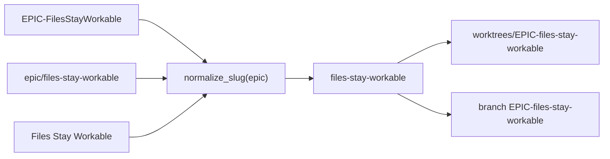

> **Parent document:** [workspace-maker-interface.md](workspace-maker-interface.md)

# Workspace Maker Work Identity and Naming

Lookup tables for how the maker turns a kind and a raw slug into a branch, a folder name and a workspace path. Verbs and flags are in the parent document.

---

## Work Identity and Naming

Source: `workspace_core.py` (`_PREFIX`, `_ALIASES`, `_WORD_FOLDED`, `_CAMEL_BOUNDARY`, `normalize_slug`, `branch_for`, `dirname_for`, `make_plan`).

| Kind | Branch | Landing folder name for slug `S` |
|---|---|---|
| `ticket` | `ticket/S` | `ticket-S` |
| `feature` | `feature/S` | `feature-S` |
| `ac` | `ac/S` | `ac-S` |
| `fastlane` | `fastlane/S` | `fastlane-S` |
| `epic` | `EPIC-S` | `EPIC-S` |
| `scratch` | none (detached at base) | `scratch-S` |

| Normalisation rule | Behaviour |
|---|---|
| Alias strip | For kind `epic`, a leading `EPIC-` or `epic/` (case-insensitive) is removed. Each alias is tried in turn. |
| Word folding | For kind `epic` only, a hyphen is inserted at each lower-case-or-digit to upper-case boundary, then the whole slug is lower-cased. Other kinds keep their case. |
| Character class | Runs of characters outside `A-Za-z0-9._-` become `-`. |
| Dots | Runs of two or more `.` collapse to one; leading and trailing `-` and `.` are trimmed. |
| `.lock` suffix | A trailing `.lock` is removed. |
| Empty result | `USAGE`. |

The workspace path is `<project parent>/worktrees/<folder name>`.

### Epic spellings that name one workspace (BO-4300a-2)

Every spelling in the first column normalises to the slug in the second, so `ensure`, `locate` and `list` resolve all of them to one workspace (`EPIC-files-stay-workable`) and one branch of the same name.

| Spelling a route uses | Used by | Normalised slug |
|---|---|---|
| `EPIC-FilesStayWorkable` | feature skill epic route | `files-stay-workable` |
| `epic/files-stay-workable` | build-feature route | `files-stay-workable` |
| `Files Stay Workable` | the epic's display title | `files-stay-workable` |
| `FilesStayPortable` | a different epic | `files-stay-portable` |

Matching is on the whole normalised slug. It is never a prefix or substring match, so `Files Stay` does not select `Files Stay Workable`. A repeat request for an existing identity answers ok with the existing `workspace_path`. It creates no second workspace or branch and moves no commit on the existing branch.

Limit: a title whose words are already lower-case with no separators (for example `filesstayworkable`) cannot be split and names a different identity.
